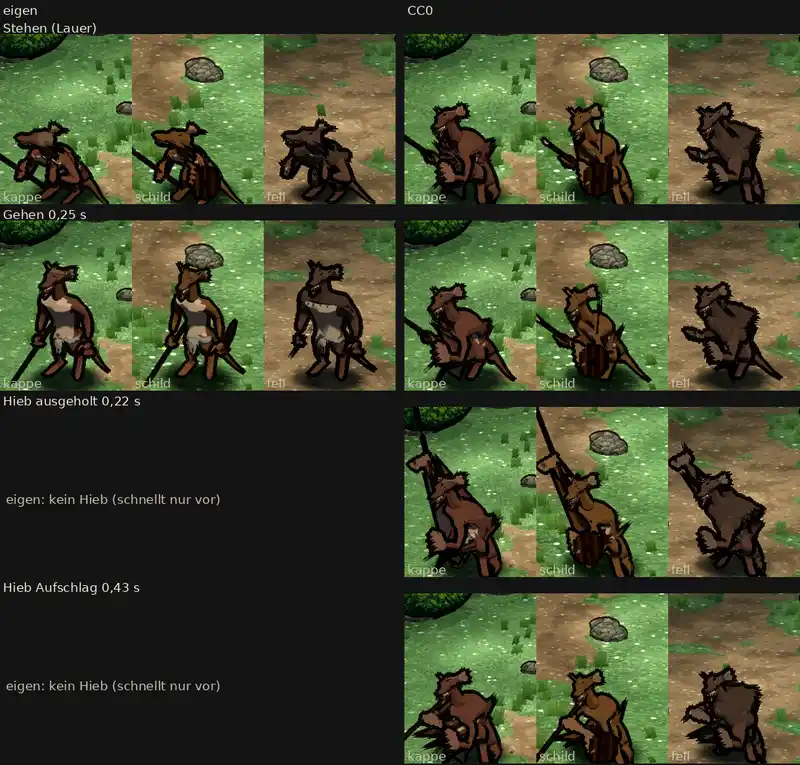

# 348.12 · Kobold auf dem CC0-Gerüst, Stand nach zwei Probeläufen: noch nicht fertig · Team Jerry · 28.10., 01:45

**Morgenblatt.** Das ist der Stand nach den zwei erlaubten Probeläufen (389). Ein Lauf zeigt den Kobold, der zweite sollte Grak zeigen. Der Kobold auf dem CC0-Gerüst ist noch nicht fertig. Ich lege ihn vor, weil die Grenze erreicht ist, nicht weil er gut ist.

**Bitte nur ansehen.** Antworte „Kobold ja“, wenn ich die Befunde unten beheben soll, oder sag, was anders sein soll.

[Film](https://cdn.jsdelivr.net/gh/tramour-cmyk/androidapp_rpg_bornim@bilder/pruefung/348.12-kobold-cc0-film.mp4), 5 s: links wie bisher, rechts CC0; Stehen, Gehen, Hieb.

**Was gebaut ist:**
- Die Kobolde stehen jetzt auf demselben Gerüst wie Goblin und Leute, mit eigener Lauer, eigenem Gang und dem Hieb.
- Die Größe stimmt: 80–87 cm, etwa halb so groß wie die Heldin.

**Was der fremde Prüfer gefunden hat** (offen):
- Die geduckte Lauer kommt im Spiel nicht an. Im Stehen stehen die Kobolde fast aufrecht, der Kopf auf 96–99 % der Höhe (bisher im Stehen 80 %). Die Schnauze zeigt 30–35° nach unten.
- Beim Schild-Kobold läuft ein dünner Strich senkrecht durch Kopf und Hals.
- Die Lederkappe ist nicht zu sehen. Stattdessen spannen sich graue Flächen vom Arm zur Hüfte.
- Beim Hieb zieht der Fellumhang mit dem Arm hoch.
- Der Speer liegt einmal waagerecht auf Hüfthöhe (Film 3,9 s). Beim Aufschlag zeigt die Spitze in den Boden.
- Der Schwanz liegt im Stehen nicht mehr am Boden.
- Der Dolch ist nicht zu erkennen.
- Im Blatt sind die Füße abgeschnitten.

**Grak:** Grak ist gebaut: 186 cm, Halbplatte, Umhang, Großaxt in beiden Händen, Hieb von oben. Im zweiten Probelauf fehlte die Axt, der Fehler lag bei mir und ist behoben. Ein Bild von Grak gibt es noch nicht.
