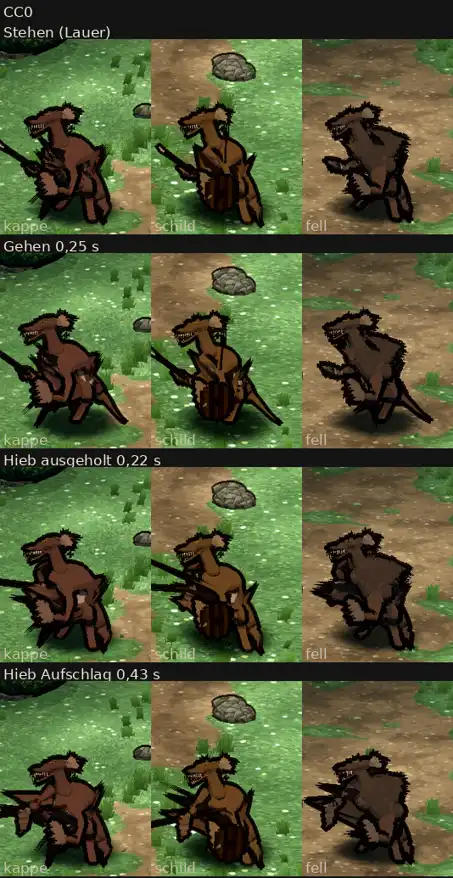

# 348.12 · Kobolde auf dem CC0-Gerüst, Runde 2: noch nicht fertig · Team Jerry · 28.10., 03:25

**Morgenblatt.** Ersetzt das Blatt von Runde 1 (01:45). Das ist der Stand nach den zwei erlaubten Probeläufen (389). Die Kobolde sind noch nicht fertig.

**Bitte ansehen:** [Film](https://cdn.jsdelivr.net/gh/tramour-cmyk/androidapp_rpg_bornim@bilder/pruefung/348.12-kobold-r2-film.mp4), Stehen, Gehen, Hieb. Antworte „Kobold ja“, wenn ich die offenen Fehler unten beheben soll, oder sag, was anders sein soll.

**Behoben seit Runde 1:**
- Speer und Dolch stechen jetzt nach vorn, statt von oben zu hauen. Der Speer geht nicht mehr durch den Kopf, die Spitze nicht mehr in den Boden.
- Der Kopf ist höher und zur Seite gedreht wie entworfen.
- Der Schwanz hängt wieder starr am Becken. Seit dem Bau von Grak hing er an Wade und Fuß, das war mein Fehler. Im Gehen liegt er jetzt am Boden.
- Das Lendentuch zieht nicht mehr mit dem Arm. Gemessen verzog es sich im Hieb um 19–22 cm, jetzt um 0–3 cm.
- Die Kappe steht doppelt so weit vom Schädel ab. Vorher lagen 43 % der Kappe im Kopf.
- Im Blatt sind die Füße nicht mehr abgeschnitten.

**Was der fremde Prüfer gefunden hat** (offen):
- Beim Schild-Kobold läuft weiter ein senkrechter Strich durch Kopf und Ohr, dazu ein Rahmen um den Hals. Die Ursache ist noch offen.
- Die Kobolde stehen fast aufrecht statt tief geduckt.
- Beim Hieb fächern schwarze Keile mit dem Arm nach vorn (Kappe und Fell).
- Im Stehen und beim Hieb steht der Schwanz schräg nach oben hinter dem Rücken.
- Die Kappe ist im Spielbild und im Blatt nicht von einem Ohr zu unterscheiden.
- Der Dolch ist nicht zu erkennen, die Hand wirkt leer.
- Die Nahaufnahmen zeigen Ohr und Hinterkopf statt Gesicht. Der Fehler liegt in der Probe.
- Im Blatt läuft der Speer über den Rand der Kachel.
