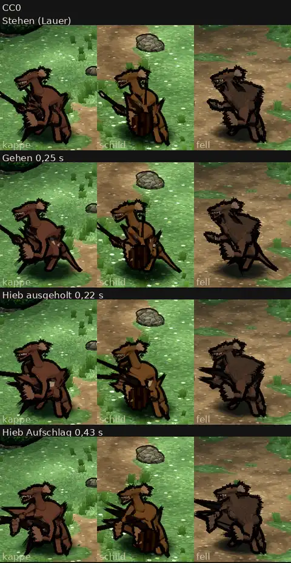

# 348.12 · Kobolde auf dem CC0-Gerüst, Runde 3: noch nicht fertig · Team Jerry · 28.10., 05:47

**Morgenblatt** (zum Ansehen am Morgen). Ersetzt das Blatt von Runde 2 (03:25). Das ist der Stand nach den zwei erlaubten Probeläufen (389: höchstens zwei Läufe je Vorlage). Gerüst = die freien Gelenke und Bewegungen (CC0), auf die wir die Figur setzen. Die Kobolde sind noch nicht fertig, kein Fehler aus Runde 2 ist sichtbar behoben.

**Bitte ansehen:** Film auf Telegram (348.12, Kobolde), Stehen, Gehen, Hieb. Antworte „Kobold ja“, wenn ich weiter an den Fehlern unten arbeiten soll, oder sag, was anders sein soll.

**Gebaut, ohne sichtbare Wirkung:** Wie bei Grak hingen Punkte der Figur an mehr als 4 Gelenken (je Kobold 189 bis 245 Punkte), das Spiel nimmt nur die 4 stärksten. Jetzt höchstens 4, und Punkte fern vom Arm hängen nicht mehr am Arm. Die schwarzen Keile beim Hieb sind trotzdem geblieben.

**Was der fremde Prüfer gefunden hat** (offen; 1 = Kappe und Speer, 2 = Schild und Speer, 3 = Fell und Dolch):
- 2: Zwei senkrechte schwarze Striche laufen vom Ohr durch den Hals bis zum Schild.
- Alle drei: Der Hals ist lang und senkrecht, der Kopf sitzt hoch. Das wirkt aufgerichtet statt tief geduckt. Gemessen im Bauprogramm sind Beine und Rumpf geduckt: Becken 24 cm hoch, Knie um 110° gebeugt, Rumpf 36° vorgeneigt. Aufgerichtet wirkt also vor allem der Hals.
- Beim Hieb fächern schwarze Keile mit dem Arm nach vorn, bei 3 am größten.
- 1 und 2: Der Schwanz steht im Stehen und beim Hieb als kurzer Zacken schräg hoch. Nur beim Gehen hängt er nach unten.
- 1: Keine Kappe zu sehen, nur die runde Ohrscheibe.
- 3: Kein Dolch zu sehen, die Hand ist ein Klumpen.
- 2: Der Schild wirkt wie ein stehendes Fass vor dem Bauch.
- 3: Er hebt sich mit dem dunklen Fell kaum vom Weg ab.
- 1 und 2: Helle Flecken an Bauch und Hüfte.
- 1: Beim Aufschlag läuft der Speerschaft quer durch den Rumpf.
- 1 und 3: Der schwarze Umriss (Tuscherand) zackt an Ellbogen und Beinen zu Splittern aus.
- Fehler der Aufnahme, nicht der Figur: Die Nahaufnahmen zeigen Hals und Rumpf statt Gesicht. Im Blatt schneidet der Kachelrand die Speere ab.
