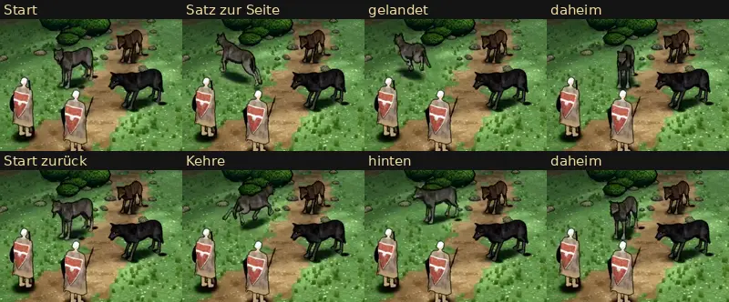

# 348.12f · Ausweichen des Kaufwolfs mit Ortswechsel · Team Jerry · 27.10., 22:50

**Frage:** Passt das Ausweichen so? Auf dein Wort 21:51 („Nur die Ausweichen-Bewegung war am Platz und ohne Ortswechsel. Ich gehe davon aus, dass das nur vergessen wurde und grundsätzlich wie bei der Ratte funktioniert“). Sag „ja“ oder was anders sein soll.

**Bitte ansehen:** [Film](bilder:pruefung/348.12f-kaufwolf-ausweichen.mp4), 6 s: ab 0,3 s „Ausweichen“ zur Seite, ab 3,1 s „Ausweichen zurück“.

**Was gebaut ist:** Das gekaufte Wolfspaket hat keine Ausweichbewegung. Darum macht der Wolf einen Satz im Lauf. Wie bei der Ratte gibt es zwei Arten: zur Seite (1,3 m) oder schräg nach hinten (1,2 m zurück, 0,7 m zur Seite), danach geht er heim. Anders als bei der Ratte läuft er dabei mit der Laufbewegung, weil ein Sprung zur Seite im Paket fehlt. Ein Ausweichen dauert so 1,2–1,3 s, bis er wieder ruhig steht. Er wählt die Seite weiter weg von den anderen Kämpfern.

**Fehlerprüfung (fremder Prüfer, eine Runde, 22:45), Zeiten im Film:**
- **Offen (mittel):**
  - Ein Busch verdeckt beim Satz zurück Kopf und Schultern, 0,2 s (ab 3,4 s).
  - Beim Satz zurück wendet er um 200° in 0,27 s, auf engem Raum.
  - Aus dem Stehen geht er in einem Bild in den Lauf, ohne Übergang. Daheim steht er noch in Sprunghaltung und steht im nächsten Bild still.
- **Offen (gering):**
  - Er bremst in einem Bild.
  - Beim Satz zur Seite dreht er sich 24° zu weit und dann zurück.
  - Beim Satz zurück läuft er erst 0,4 m nach vorn, dann wendet er.
  - Den Heimweg rennt er statt zu gehen.
- **Bekannt:** Zum Heimgehen dreht er sich weiter auf der Stelle, wie bei der Ratte. Einen Heimweg im Bogen habe ich gebaut und wieder ausgeschaltet: Der Prüfer fand nach dem Biss Wenden mit 16–20 cm Radius (175° in 0,23 s, vorher 180° in 0,4 s), beim Anlauf einen ganzen Kreis und beim Platzwechsel eine Schleife bis aus dem Bild.

**Danach:** Die offenen Punkte und das Drehen auf der Stelle behebt mein Nachfolger.
