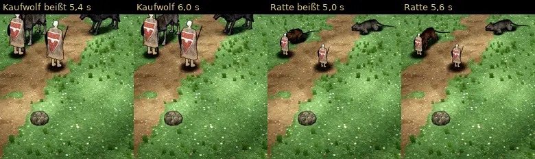

# 348.12f · Ratte und Kaufwolf beißen näher; der Kopf verschwindet dabei hinter der Heldin · Team Jerry · 28.10., 10:00

**Frage:** Ratte und Kaufwolf treten zum Biss jetzt 10 cm näher heran, wie du gesagt hast. Die Nase reicht dann bis 11–13 cm in den Umriss der Heldin. Im Bild berührt sie die Heldin, ohne sichtbar in ihr zu stecken. Dabei verschwindet der Kopf hinter ihr: beim Kaufwolf 1,6 s lang beim Biss und noch einmal 1,6 s beim Sprung. Man sieht dann einen Wolf ohne Kopf an ihr. Soll das so bleiben (a), oder sollen sie so weit zurück, dass die Nase gerade am Umriss endet, etwa 12 cm (b)?

**Votum:** b. Der Biss soll zu sehen sein.

**Bitte ansehen:** [Film](https://cdn.jsdelivr.net/gh/tramour-cmyk/androidapp_rpg_bornim@bilder/pruefung/348.12f-r8.mp4), 58 s: Kaufwolf 0–29 s, Ratte ab 29 s. Biss je ab etwa 2,5 s, Ausweichen ab etwa 8 s, Sprung ab etwa 15 s (Ratte jeweils 29 s später).

**Geändert:**
- Biss 10 cm näher (siehe Frage).
- Pfotenflecken: Beim Kaufwolf lag der kleine dunkle Fleck je Pfote 18–25 cm vor der Pfote. Der gekaufte Knochen der Pfote liegt waagerecht, ich hatte ihn wie beim eigenen Wolf verlängert. Das ist behoben: Im neuen Film liegt bei laufender Pfote kein Fleck mehr daneben (gemessen).

**Was der fremde Prüfer gefunden hat:**
- Beim Umdrehen bleibt zweimal (Film 9,3 und 12,2 s) ein scharfer schwarzer Fleck 40–50 Bildpunkte neben der Pfote 3–5 Bilder lang stehen. Dazu meine Messung: Kommt das Bein beim Umdrehen nicht bis zur Stelle, an der die Pfote stehen soll, zieht die Pfote mit dem Körper weiter, der Fleck bleibt zurück. Die Messung zeigt das in jedem dieser Bilder. Ich habe es im Code behoben; im Film ist es noch nicht zu sehen, weil die zwei erlaubten Probeläufe verbraucht sind.
- Gleiten: Laut Messung rutschen die Pfoten trotz Halten noch, beim Wolf je Abschnitt 1,6–3,3 m, bei der Ratte bis 5,9 m. Beim schnellen Rückweg nach dem Ausweichen hält die Ratte ihre Pfoten gar nicht.
- Ratte geht nach dem Ausweichen ohne sichtbare Schritte heim, die Vorderpfote rutscht in 0,5 s etwa 100 Bildpunkte. Beim schnellen Rückweg sieht man die Beine einige Bilder nicht.
- Ratte beim Umdrehen: Die Hinterbeine stehen kurz bis auf Rückenhöhe nach hinten, ein Bein ragt neben dem Kopf heraus (Film 39,4 s).
- Ratte beim Biss: Der Kopf ragt auf der anderen Seite der Heldin 17–27 Bildpunkte heraus. Beim Sprung (Film 46,1 s) fliegt sie 0,03 s lang über den Kopf der Heldin.
- Größe: Der Kaufwolf ist so hoch wie die Heldin, beim Biss liegt seine Nase 1,0–1,4 m hoch. Die Ratte ist größer als die Heldin.
- Heldin (Team Tom, an Tom offen): Beim Biss und beim Sprung steht sie je ein Bild in Gehhaltung. Beim Treffer rutscht sie 0,3 s lang ohne Schritte zur Seite. Im Rattenfilm ist sie halb so groß wie im Wolffilm.
- Im Rattenfilm bricht die Zugleiste oben in eine zweite Zeile um.
- In Ordnung: kein Teil des Tiers über der Heldin außer beim Rattensprung, kein Schweben, nichts im Boden, kein Kreuzen der Beine beim Wolf, Tod ohne Befund.

**Danach:** Ich baue deine Antwort zum Biss ein und gehe Heimweg, Gleiten und Beine der Ratte an. Der Pfotenfleck beim Umdrehen kommt mit dem nächsten Film.
