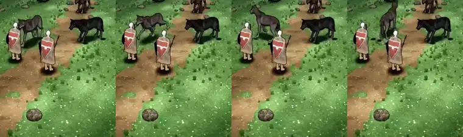

# 348.12f · Ratte und Kaufwolf drehen sich auf der Stelle mit Schritten · Team Jerry · 28.10., 00:50

Im Bild ist der graue Wolf oben links der Kaufwolf, die Heldin trägt den roten Schild.

**Zwei Fragen** (offene Befunde aus deiner Abnahme 21:26, „Umdrehen, Schnauze“):
1. **Passt das Umdrehen so?** Sag „ja“ oder was anders sein soll.
2. **Schnauze: so lassen oder 10 cm näher?** Mein Votum ist „näher“, damit der Biss die Heldin wirklich trifft. Dagegen spricht: Im Bild ragt die Schnauze dann noch weiter über die Heldin.

**Bitte ansehen**, jeweils nur die rechte Hälfte (gekauftes Tier; links läuft unser altes, nicht zeitgleich):
- [Film Kaufwolf](bilder:pruefung/348.12f-kaufwolf-drehen.mp4), 29 s: nach dem Biss ab 5,2 s ein Schritt rückwärts, Drehung 5,9–6,3 s.
- [Film Ratte](bilder:pruefung/348.12f-ratte-drehen.mp4), 30 s: Drehungen bei etwa 5,1 s, 6,0 s, 6,8 s, 9,0 s und 18,7 s; Biss bei 4,0 s.

**Was gebaut ist:**
- Dreht sich ein Tier auf der Stelle um, bleiben seine Pfoten am Boden stehen. Sie treten nach, immer zwei über Kreuz zugleich. Vorher drehten sie 15–25 cm am Boden mit.
- Die Drehung dauert dafür länger: 180° in 0,75 s statt 0,4 s.
- Nach dem Biss geht der Kaufwolf erst einen Schritt rückwärts, dann dreht er sich. Vorher drehte er sich direkt an der Heldin, und sein Kopf schwang durch sie hindurch. Jetzt bleibt seine Nase beim Drehen mindestens 40 cm von ihr weg.

**Was der fremde Prüfer gefunden hat:**
- Die Pfoten des Wolfs treten nach und gleiten nicht. Bei der Ratte sieht er kein deutliches Gleiten mehr. Ihre Beine sind im Film aber nur 2–3 Bildpunkte breit.
- Offen:
  - Beim Treten spreizen sich die Beine manchmal weit oder kreuzen sich (Wolf 5,5 s, Ratte 6,2 s und 10,3 s).
  - Unter dem Wolf liegt ab 6,3 s ein schwarzer Fleck neben einer Pfote. Das ist ihr Schatten, an der falschen Stelle.
  - Die Ratte gleitet nach dem Ausweichen langsam heim, fast ohne sichtbare Schritte (9,4–10,2 s).
  - Schnauze: Der Prüfer sieht die Schnauze der Ratte beim Biss links neben dem Kopf der Heldin herausragen (4,0–4,2 s). Gemessen beißt sie aber 14–16 cm vor Beinen und Rumpf der Heldin ins Leere, der Wolf ebenso. Im Bild liegt der Kopf vor der Heldin, im Raum berührt er sie nicht.
- Nicht von Team Jerry: Die Heldin macht alle 3 s einen kurzen Schritt. Das gehört Team Tom.

**Danach:** Nach deinem Wort baue ich das ein und behebe die offenen Punkte.
