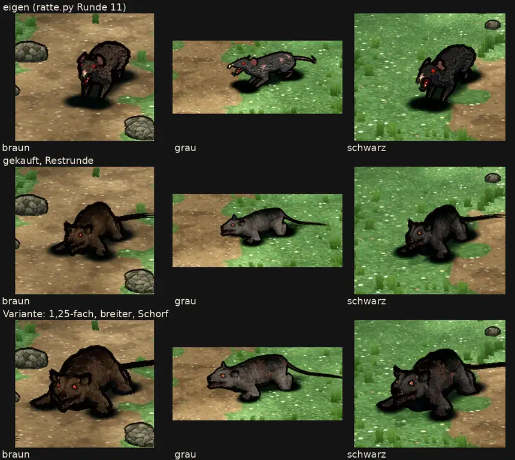

# 348.12f · Letzter Vergleich Ratte: eigene oder gekaufte? · Jerry · 27.10., 16:10

**Frage:** Die Ursache des Rutenfehlers ist gefunden und behoben (dein Wort 27.10., 09:57: „sodann abschließende Vorlage … zum finalen Vergleich“). Bleibt die eigene Ratte („eigen“), oder kommt die gekaufte ins Spiel („gekauft“)? Bei „gekauft“ folgt Kauf Stufe 2 (348.12c).

**Votum Jerry: „eigen“.** Die Rute ist jetzt in allen Bewegungen sichtbar. Offen sind an ihr noch die zerfaserte Spitze und der Rand im Vergleichsbild. Die übrigen Fehler der gekauften stecken in den Bewegungen der Quelle, und mehr verschiedene Bewegungen hat sie nicht (Vorlage r3). Stärkstes Gegenargument: Auf dem Standbild wirkt die gekaufte ausdrucksstärker. Bitte die Filme ansehen: [Film 1](https://cdn.jsdelivr.net/gh/tramour-cmyk/androidapp_rpg_bornim@bilder/pruefung/348.12f-r7-1.mp4) (links eigen, Mitte gekauft, rechts Variante), [Film 2](https://github.com/tramour-cmyk/androidapp_rpg_bornim/blob/bilder/pruefung/348.12f-r7-2.mp4) (alle Bewegungen der gekauften einzeln). Beide Filme auch per Telegram (27.10., 17:57).

**Berührt:** Riesenratte Kapitel 1; Kauf Stufe 2 (348.12c); Einbau gekaufter Modelle (348.12i, Tom); Janpec-Wolf als nächste Probe.

## Sachverhalt

**Ursache der Rute (meine Messung):** Die Rute war zur Seite hinter den Körper gebogen. Ihre Spitze erschien darum als Strähnen über der Schulter, und in 12 von 15 Bewegungen sah man die Rute gar nicht. Jetzt ist sie anders gebogen: Die Spitze liegt seitlich 76–145 px neben dem Becken und ist überall sichtbar. Sie zeigt weiterhin von der Kamera weg.

**Fremde Prüfung (27.10., 16:04, Film 2 Bild für Bild, kein Befund „hoch“):**
- **Behoben:**
  - Die Rute ist in allen 15 Bewegungen sichtbar. Sie knickt nicht mehr plötzlich zum Haken ab, die Spitze bewegt sich höchstens 9 px je Bild.
  - Im Vergleichsbild ist die Rute etwa 0,7 Körperlängen lang (vorher 0,36).
  - Beim Drohen ist der helle Stummel weg.
  - Die Schatten lösen sich bei Sprüngen nicht mehr von den Pfoten.
  - Hocke: Der Rücken senkt sich jetzt um 16 px (vorher 7), der Kopf aber nur um 1–2 px.
  - Kein Titel ist mehr abgeschnitten.
- **Offen (mittel):**
  - Gehen: In zwei Abschnitten (3,4–3,6 s und 4,5–4,6 s) steht ein Hinterfuß über der Rückenlinie, etwa 25×30 px. Gegenüber r6 ist das eher größer geworden. Beim Rennen ragt bei 4,8 s eine Pfote über Kopf und Rücken; das kommt aus der Quelle.
  - Tod: Der Kopf dreht sich in die Schulter. Zähne und Augenglanz scheinen 3 Bilder lang als weiße Punkte durch das Fell (etwa 40 px).
  - Ausweichen links: Der Kopf rutscht unter die Vorderbeine, das Ohr verschwindet in der Schulter. Dazu sind 2 Bilder lang 2–3 dünne Linien über dem Gesicht zu sehen (Rest der Strähnen, in r6 noch „hoch“).
  - Biss und Sprungbiss gehen zur Kamera, 40–50° an den Helden vorbei.
  - Im Vergleichsbild oben ist die Rute bei 5 von 6 gekauften Ratten am Rand abgeschnitten.
- **Offen (gering):**
  - Drohen (gering bis mittel, Verdacht): Die Schnauze liegt auf oder in der Rückenlinie.
  - Die Rutenspitze zerfasert auf den letzten 20–28 px in 2–3 Zinken. Laut Bauprotokoll liegt sie vielleicht 2 cm unter dem Boden (Verdacht).
  - Ausweichen rechts: Eine Vorderpfote ragt neben dem Ohr heraus. Die Ratte rückt eher zum Gegner als zur Seite (Verdacht).
  - Im Vergleichsbild sind in „Variante braun“ links unten kleine Strichreste.
- Aus r3, nicht neu geprüft: Die gekaufte ist größer als die Helden, ihr Gesicht ist in Spielgröße kaum lesbar.

**Messung Diogenes (27.10., 17:0x, nur Hinweis):** Die gekaufte ist so hell wie die eigene (−3 bis +3 %). Die Variante ist dunkler (−7 bis −18 %). Der gekauften fehlen die rosa Ohren und die Wunden der eigenen. Ihr Maul ist zu, die eigene zeigt bei grau und schwarz die Zähne. Ihre Augen sind orange-rot statt rot. Im Vergleichsbild ist der Schwanz angeschnitten, bei der gekauften im braunen und schwarzen Fell, bei der Variante in allen drei Fellen.

**Sag:** „eigen“ oder „gekauft“.
