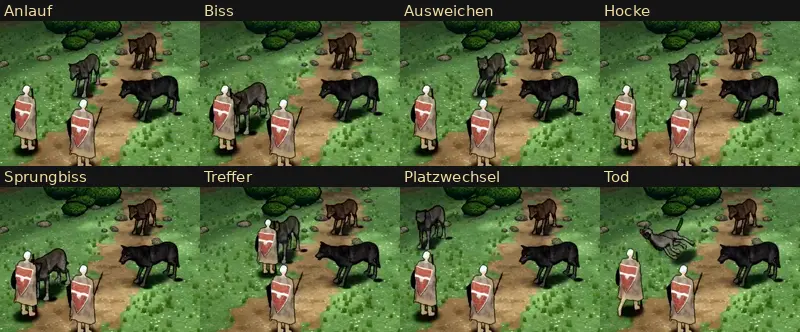

# 348.12f · Gekaufter Wolf im Kampfort neben unserem · Jerry · 27.10., 21:44

**Bitte ansehen (Morgenblatt):** [Film Ortswechsel](bilder:pruefung/348.12f-kaufwolf-ort.mp4) (links unser Wolf wie bisher, rechts der gekaufte Janpec-Wolf), [Film alle Bewegungen](bilder:pruefung/348.12f-kaufwolf-alle.mp4), [Standbild-Blatt](bilder:pruefung/348.12f-kaufwolf-blatt.jpg) (oben unsere Wölfe grau, dunkel, rost; unten die gekauften in denselben Fellen).

**Frage:** Nehmen wir den gekauften Wolf mit unserer Bemalung, wie bei der Ratte? Auf deine Frage 18:09 („Was ist mit dem Kaufwolf? Den nehmen wir nicht? Oder seine Animationen?“). Seine Bewegungen allein passen nicht auf unseren Wolf, weil die Knochen anders gebaut sind; darum zeigt die Probe den ganzen gekauften Wolf. Sag „gekauft“, „eigen“ oder was anders sein soll.

**Was gebaut ist (nur der gekaufte Wolf):**
- Körper und Bewegungen aus dem Kauf, 5.612 Dreiecke (unter 6.000).
- Bemalung von uns: die Fellzeichnung aus dem Bild des Kaufs, die Farben unserer vier Felle (grau, dunkel, rost, asche), unsere Fellstriche, unsere Tusche-Linien.
- Größe wie unser Wolf: Rücken 0,94 m.
- Bewegungen aus dem Kauf: Stehen, Stehen mit Umschauen, Gehen, Rennen, Biss, Heulen, Tod.
- Treffer, Ausweichen und Hocke gibt es im Kauf nicht. Sie sind von uns aus der Ruhehaltung gemacht: Der Rumpf weicht aus, die Pfoten sollen stehen bleiben (siehe Offen).
- Der angesagte Sprung ist derselbe Biss wie der normale.
- Ortswechsel wie bei der Ratte: Er geht und rennt im Tempo seiner Beine. Zum Biss rennt er bis vor die Heldin, danach rennt er heim.
- Beim Zubeißen zeigt die Schnauze auf die Heldin (±2°). Gemessen gegen ihren Umriss am Boden steckt die Nase höchstens 1 cm darin.

**Fehlerprüfung (fremder Prüfer, eine Runde, 21:18), danach behoben und selbst nachgemessen, ohne zweite Prüfung im Bild:**
- **Behoben:**
  - Beim Platzwechsel lief er zwischen zwei Rudelwölfe und steckte 20–35 cm in ihnen. Der Platz war im Prüfaufbau falsch gewählt, im Spiel wechselt er nur auf freie Plätze. Jetzt hat er dort 1,9 m Luft.
  - Er war deutlich heller als unser Wolf, mit fast weißen Unterbeinen (Wolfsfläche grau 82 gegen 62, dunkel 73 gegen 44, rost 70 gegen 31). Jetzt gemessen an der Fläche um jeden Wolf: grau und rost gleich hell wie unsere, dunkel etwas dunkler. Helle Stellen an den Beinen: grau und rost so viele wie bei unseren, dunkel 1,2 % gegen 0,7 %. Asche ist nicht gemessen, weil im Kampfort nur drei Wölfe stehen.
  - Der Tod: Vorher begann das Ausblenden noch im Fall. Jetzt fällt er in 0,5 s, liegt 0,3 s und blendet dann aus.
  - Beim Biss verschwand der Kopf hinter der Heldin. Er beißt jetzt 3 cm weiter vor ihr. Ob der Kopf im Bild jetzt sichtbar bleibt, hat niemand nachgesehen.
  - Das Bild oben zeigt jetzt Titel und nur den Ausschnitt um Heldin und Wolf.
- **Offen (mittel):**
  - Beim Umdrehen auf der Stelle drehen sich die Pfoten 15–25 cm mit, ohne Schritt. Das ist derselbe Befund wie bei der Ratte, den du mit ihr zum Beheben gegeben hast. Ich behebe ihn für beide zusammen.
  - Am Heimplatz liegt das Laub eines Buschs über seinem Kopf. Die Ursache ist nicht geprüft.
  - Der Biss des Kaufs senkt erst den Kopf und stößt dann vor. Er dauert 1,4 s, unser Richtwert ist 0,6 s (eigener Befund).
- **Offen (gering):**
  - Beim Ausweichen spreizen sich die Beine in 0,1 s, ein Vorderfuß wandert etwa 5–10 cm.
  - Im Film aller Bewegungen heben alle drei Wölfe beim Übergang in den Tod kurz bis 0,4 m ab. Gesehen im ersten Film, vor der Änderung am Tod; der neue Film ist darauf nicht geprüft, die Ursache auch nicht.
  - Die zwei übrigen gekauften Wölfe stehen im Film „Ortswechsel“ fast still. Im Film aller Bewegungen bewegen sie sich beim Stehen.
  - Im Standbild-Blatt steht zwischen den Bildern ein schwarzer Streifen. Das liegt am Blatt, nicht am Wolf.

Vor dem Eigenbau geprüft: Gekauft ist der Janpec-Wolf, er ist genommen. Treffer, Ausweichen und Hocke fehlen im Janpec-Paket.

**Danach:** Bei „gekauft“ kommt der Wolf wie die Ratte mit der Verschlüsselung der Kaufmodelle (348.12i, Tom) ins Spiel. Die übrigen gekauften Tiere prüfe ich gerade auf Bewegungen und Bemalung (387).
