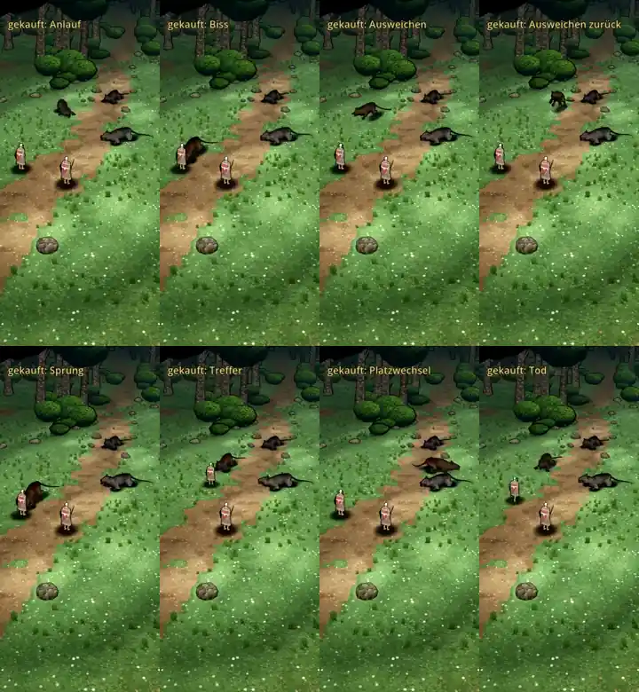

# 348.12f · Gekaufte Ratte bewegt sich im Kampfort von Ort zu Ort · Jerry · 27.10., 20:33

**Bitte ansehen:** [Film](bilder:pruefung/348.12f-ort-r2.mp4) (links unsere Ratte wie bisher, rechts die gekaufte mit Ortswechsel).

**Frage:** Passen die Bewegungen der gekauften Ratte? Auftrag laut Archiv (27.10., 18:01): Bewegungen mit Ortswechsel im Kampfort zeigen, nicht auf der Stelle; Biss zum Helden nachjustieren. Sag „ja“ oder was anders sein soll.

**Was gebaut ist (nur die gekaufte Ratte):**
- Platzwechsel und Anlauf: Sie geht oder rennt im Tempo ihrer Laufbewegung, statt zu gleiten.
- Ausweichen: zur Seite oder zurück, dann geht sie heim.
- Biss: Sie rennt bis vor die Heldin und beißt. Bei angesagtem Sprung springt sie an. Danach macht sie einen Satz zurück und rennt heim.
- Beim Zubeißen zeigt die Schnauze auf die Heldin (±2°) und steckt höchstens 3 cm in ihrem Rand.
- Umdrehen: 180° in 0,4 s, dabei höchstens ein Schritt (siehe Offen).

**Fehlerprüfung (fremder Prüfer: Prüfung und Nachprüfung, 20:30):**
- **Behoben:**
  - Vorher drehte sie sich zehnmal in einem einzigen Bild um 90–187°.
  - Am Start des Anlaufs steckte ihr Hinterteil im Kopf der Ratte dahinter.
  - Beim Biss steckte die Nase bis 12 cm in der Heldin.
- **Offen (hoch, nur in der Probe):** Am Start des Anlaufs springt sie in der Probe um 3 m an den Startplatz. Der Film beginnt deshalb erst danach. Im Kampf gibt es diesen Sprung nicht, er kommt vom Aufbau der Probe.
- **Offen (mittel, Verdacht):**
  - Beim Umdrehen auf der Stelle macht sie höchstens einen Schritt. Die Hinterpfoten müssten dabei rutschen. Bei der Filmgröße war das nicht messbar.
  - Beim Biss ragt die Schnauze im Bild etwa 10 cm über den Umriss der Heldin. Gemessen ist die Nase dabei 11–13 cm vor ihr.
- **Offen (gering):**
  - Nach dem Platzwechsel reicht die Rute an den rechten Bildrand. Der Platz ist von der Probe gewählt.
  - Links und rechts laufen nicht gleichzeitig: Die Abschnitte unserer Ratte sind kürzer, weil sie nicht hin- und herläuft.
  - Beim Umdrehen am neuen Platz steht sie dicht hinter einer anderen Ratte. Ein Durchdringen ist nicht zu sehen.
- **Links, unsere Ratte, wie bisher:** Sie gleitet ohne Schritte, springt nach dem Biss heim und dreht sich in einem einzigen Bild um 180°. Darum zeigt der Film den Unterschied.

**Danach:** Bei „ja“ kommt der gekaufte Janpec-Wolf als nächste Probe, auf dieselbe Art (auf deine Frage 18:09 nach dem Kaufwolf). Der Einbau ins Spiel folgt nach der Verschlüsselung der Kaufmodelle (348.12i, Tom).
