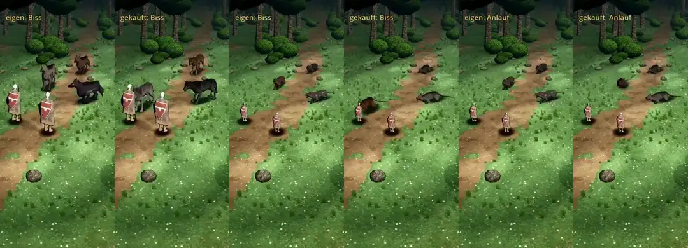

# 348.12f · Kaufwolf und Ratte, letzte Runde: Biss nach b, Schatten der Ratte · Team Jerry · 28.10., 11:44

**Bitte ansehen:** [Film](https://cdn.jsdelivr.net/gh/tramour-cmyk/androidapp_rpg_bornim@bilder/pruefung/348.12f-r9.mp4), 58 s: Kaufwolf 0–29 s, Ratte ab 29 s, je links unser eigenes Tier, rechts das gekaufte. Biss je ab etwa 2,5 s, Ausweichen ab etwa 8 s, Sprung ab etwa 15 s (Ratte jeweils 29 s später).

**Geändert (deine Antwort b, 10:36):**
- Biss: beide Kauftiere bleiben so weit weg, dass die Nase am Umriss des Helden endet. Gemessen beim Kaufwolf: Nase 1 cm vor dem Rand (vorher 11–13 cm darin). Bei der Ratte liegt die Nase im gemessenen Ausschnitt des Bisses 10–11 cm vor dem Rand; den Rest des Bisses hat der Lauf nicht mitgeschrieben.
- Schatten der Ratte: Die „schwarzen Scheiben“ waren die kleinen Schattenflecken unter jeder Pfote. Sie wuchsen mit der Größe des Tiers und waren bei der Ratte je Pfote 52 × 64 cm groß, doppelt so groß wie beim Wolf. Jetzt sind sie im Verhältnis zum Tier so groß wie beim Wolf (17 × 21 cm), und der weiche Schatten unter dem Körper ist so breit, dass die Pfoten an seinem Rand stehen wie beim Wolf.

**Zu deinen Fragen zum Schatten:**
- Sonnenstand: Es ist der Stand, den du am Morgen mit der Tusche nach Licht abgenommen hast (45° hoch, von schräg vorn links). Der echte Schatten, den die Sonne wirft, fällt danach schräg nach hinten; beim Wolf reicht der Schatten des Kopfes 1,4–1,6 m weit.
- Der weiche dunkle Fleck unter dem Körper und die Pfotenflecken kommen nicht von der Sonne. Sie sind wie im alten Spiel dazugelegt, damit die Tiere nicht schweben. Darum liegen sie immer genau unter dem Tier.

**Was der fremde Prüfer findet,** schicke ich danach als Text (Archiv 396).

**Danach:** In Ratte und Kaufwolf stecke ich keine Arbeit mehr, wie du gesagt hast.
