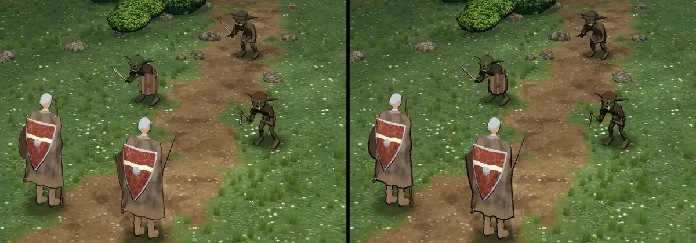

# 348.13a · Tusche im Kampf nach Licht, Runde 7: 1,0 oder 1,3? · Tom · 27.10., 17:45

**Frage:** Welche Linie am Umriss: links (1,0: Linie wie bisher im Kampf) oder rechts (1,3: auf der Schattenseite der Figuren zusätzlich breiter)?

**Votum Tom: links (1,0).** Ruhigere Umrisse, Goblins und Fäuste lesbarer, Scheide und Stab sauberer. Stärkstes Gegenargument: dein Auftrag vom 27.10., 09:41 war „kräftiger“; links fehlt genau diese zusätzliche Breite. Die offenen Punkte unten behebe ich vor der Übergabe an Jerry, wenn du nichts anderes sagst.

Ortsangaben unten gelten in jeder Bildhälfte gleich.

**Berührt:** Kampfort (Jerry, 348.7), Goblins (348.12).

## Sachverhalt

**Geändert seit der letzten Vorlage:** breite Linie nur am Umriss und nur auf der Schattenseite (Runden 4–5); schmale Teile bekommen weniger Band, unter 0,3 m keines (Runde 6); Goblins hatten die Tusche der Welt, 1,8-mal so breit wie am Helden, jetzt dieselbe wie der Held (Runde 7, nur in der Probe).

**Fremde Prüfung (17:39), offen:**
- **Goblins dunkel** (mittel bis hoch): etwa die Hälfte des Schwarz ist ihre Grundfarbe, der Rest Umriss und Innenlinien. Hand am Säbel (Goblin oben rechts) ein schwarzer Keil; über Brust und Arm (Goblin unten rechts) ein X aus Innenlinien.
- **Sohle des linken Helden** dick und gezackt (mittel), unabhängig von der Stärke; Ursache noch nicht nachgestellt.
- **Rechter Held:** Schweif an der Scheidenspitze, Stab an der Mantelkante doppelt (mittel; bei 1,0 dünner); Waffe ganz schwarz, ohne Metall (mittel).
- **Licht- und Schattenseite kaum verschieden** (mittel): die Sonne steht im Kampf hoch und genau von vorn; die linke und rechte Seite jeder Figur bekommen gleich viel Licht, darum gleich dicke Linien. Eine Probe mit der Sonne etwas von der Seite ist gerendert, noch ungeprüft; das Licht im Kampf gehört Jerry.
- Gering: beide Helden sehen gleich aus; Felsen und Stämme fast ohne Tusche.
