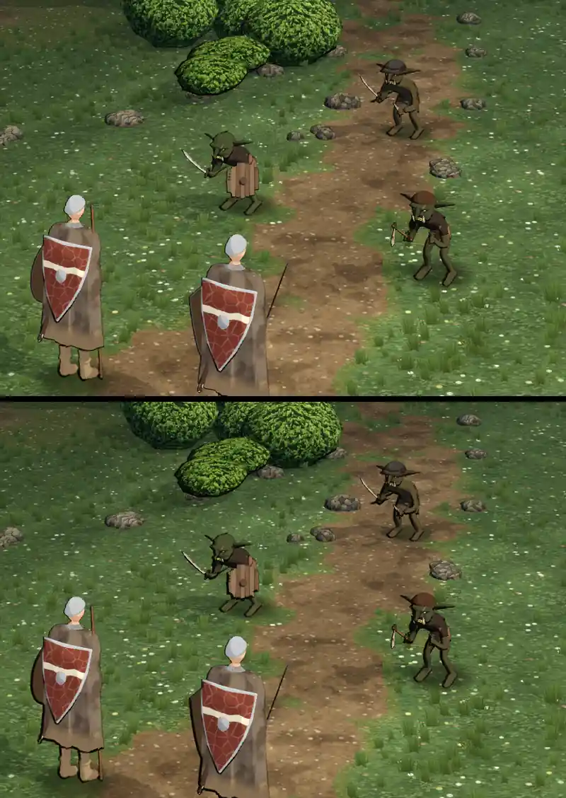

# 348.13a · Tusche im Kampf mit schräger Sonne: 1,0 oder 1,3? · Tom · 27.10., 20:04

**Frage:** Welche Linie am Umriss, jetzt mit Sonne schräg von rechts: obere Bildhälfte (Linienstärke 1,0 = wie bisher im Kampf) oder untere (1,3 = auf der Schattenseite zusätzlich breiter)?

**Votum Tom: untere Hälfte (1,3).** Nur dort ist die Schattenseite dicker als bisher (dein Wort 19:07: „damit wir dünne und dicke Tuscheseiten haben“): links an den Figuren 4–6 Bildpunkte, rechts dünn bis keine Linie. In der oberen Hälfte entsteht der Unterschied nur, weil rechts die Linie fast fehlt. Stärkstes Gegenargument: bei 1,3 werden die offenen Fehler (siehe Sachverhalt) deutlicher; bei 1,0 sind die Umrisse ruhiger.

**Berührt:** Kampfort und Licht im Kampf (Jerry, 348.7), Goblins (348.12).

## Sachverhalt

**Geändert seit Runde 7:** Sonne nicht mehr hoch von vorn, sondern schräg von rechts (Höhe 45°, 55° zur Seite); Schatten fallen nach links. In der ersten Probe (Sonne 25° zur Seite) fiel das Licht am Bildschirm kaum schräg ein (11°), Linien links und rechts gleich dick (je etwa 3 Bildpunkte); darum die stärkere Drehung. Die Lichtung wird dadurch nicht dunkler (Helligkeit gleich).

**Fremde Prüfung (19:58), offen** (Orte gelten in beiden Bildhälften):
- **Linienstärke 1,0:** die Schattenseite ist nicht dicker als bisher (1–3 Bildpunkte); rechte Mantelränder beider Helden verschwimmen mit dem Untergrund (links Gras, rechts Weg) (mittel).
- **Goblins dunkel** (mittel): Helligkeit etwa 75 gegen 100 bei den Helden; Oberkörper des hinteren Goblins (auf dem Weg) und Brust und Arm des vorderen Goblins rechts fast schwarz gefüllt; Hand am Säbel des hinteren Goblins ein schwarzer Keil, bei 1,3 stärker. Der hintere Goblin hebt sich auf dem braunen Weg kaum ab.
- **Rechter Held:** Strich von der Scheidenspitze nach rechts unten, bei 1,3 dick (mittel); Speer ganz schwarz, ohne Holz (gering); am Bildrand unten abgeschnitten.
- Gering: Unterkante des Holzschilds (linker Goblin) bei 1,3 dick und ausfransend; Sohle des linken Helden bei 1,3 dicker; beide Helden gleiches Modell; Hände unter dem Mantel nicht sichtbar.
- Erledigt seit Runde 7: Stab an der Mantelkante nicht mehr doppelt; Kreuz aus Innenlinien am Goblin nicht mehr zu sehen; keine dicke Linie auf der falschen Seite.

## Folgerungen

Nach deiner Wahl: Linienstärke und Sonnenstand an Jerry (Licht im Kampf gehört ihm), dazu die offenen Punkte oben; Goblins aufhellen übernimmt Jerry.

Antwort: 1,0 oder 1,3
