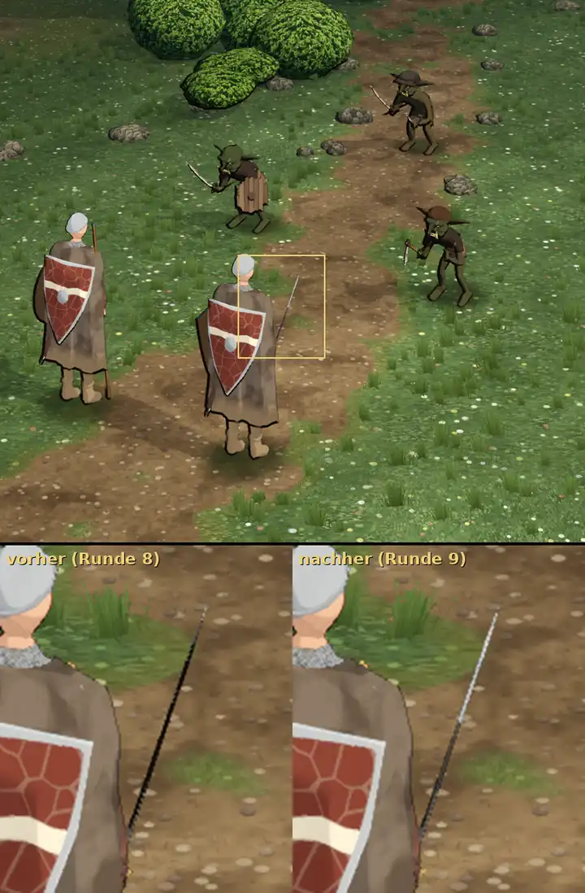

# 348.13a · Tusche im Kampf, Runde 9: Langschwert nicht mehr schwarz · Tom · 28.10., 00:59

**Ansehen (Morgenblatt):** unten rechts gegen links: die Klinge des Langschwerts ist nicht mehr schwarz.

**Geändert, zwei Ursachen nachgestellt:**
1. Teile, die am Schirm höchstens 3 Bildpunkte schmal sind (Klinge von der Schneide gesehen), bekommen keine Tuschelinie mehr; vorher deckte die Linie (2–3 Bildpunkte) die Klinge (1 Bildpunkt) ganz.
2. Die Hohlkehle färbte eine ganze Klingenhälfte auf zwei Dritteln der Länge fast schwarz (auch das Kurzschwert); jetzt nur etwas dunkler als der Stahl. Untere Klinge gemessen: vorher 265–324, nachher 399–454 (obere Klinge 545–590; Summe RGB).

Sonst gleich wie Runde 8 mit deiner Wahl 1,3.

## Befund der fremden Prüfung (00:5x), offen

- **Schwert liest sich als Stab oder Draht** (mittel): 1–2 Bildpunkte hell, ohne Griff, Parierstange und Hand (vom Mantel verdeckt), untere Hälfte dunkler gestreift als die obere, wie zwei Materialien; entlang der Klinge Treppe einer 1-Bildpunkt-Schräge (gering bis mittel).
- Säbel des hinteren Goblins liest sich als Bogen (gering), vermutlich Folge von 1.
- Linker Goblin steht im Profil quer zu den Helden (gering bis mittel); hinterer Goblin hebt sich auf dem Weg schwach ab (gering; Goblins aufhellen übernimmt Jerry).
- Beide Helden fast gleich, Schild mittig auf dem Rücken (mittel; Modell, nicht Tusche); Scheidenende unten links am Mantel ein dunkler Stummel (gering).

**Aus Runde 8 nachgestellt, nicht geändert:** „Strich von der Scheidenspitze“ ist der untere Mantelsaum (Schattenseite, 4–5 Bildpunkte wie der Außenumriss); Unterkante des Goblinschilds folgt den Plankenstufen; Sohle ist eine Kontaktlinie der Welttusche plus feine Heldenkante, unabhängig von 1,0 oder 1,3.

**Weiter:** Linienstärke 1,3, Sonne und die offenen Punkte gehen an Jerry (Licht im Kampf, Goblins); Schwert im Kampf (Lage, Griff sichtbar) mit 372 Feinschliff Held.
