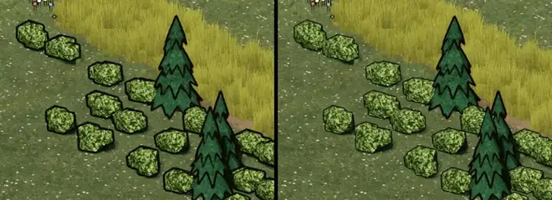

# 348.6 · Büsche: Tusche nach dem Licht, so richtig?
Tom · 25.10., 10:49 · G Stil · M (Runde 9; Chef 25.10., 10:16 bestätigt: Kontur nach Licht und Schatten)

## Frage

Wirken die kleinen Büsche jetzt nicht mehr „abgeknüdelt“? Ja → bleibt so; nein → was stört?

## Empfehlung

Ja. Links alt, rechts neu (Ausschnitt aus dem Standbild am Fluss, Wiese am Tag).

## Berührt

348.6 (Umzug Godot, Dorf).

## Begründung

Du hast entschieden: Kontur auf der Lichtseite dünn oder weg, auf der Schattenseite kräftig.

## Sachverhalt

- Die Büsche zeichnen ihre Kontur jetzt selbst mit, sie wird nicht mehr über das fertige Bild gelegt. Auf der Schattenseite ist sie kräftig, auf der Lichtseite dünn.
- Der Bildschirmfilter zeichnet in den Büschen keine Linien mehr. An der Bodenseite des Umrisses bleibt eine dünne Linie.
- Im Ausschnitt ist der Anteil dunkler Bildpunkte an den Büschen um etwa 40 % kleiner.

## Auswertung

Fremder Prüfer, zwei Runden: Die Kontur ist links und oben dünn und rechts kräftig, das passt zum Licht. Es bleibt:
- Ringsum bleibt eine dünne Linie, auch auf der Lichtseite (sie ist dünn, aber nicht ganz weg).
- Zwischen den Ballen gibt es dunkle Kerben. Gemessen sind sie jetzt heller als vorher.
- Die Büsche sind eckige Vielecke, eher Steine mit Laub als Ballen. Das ist eine Frage der Form, nicht der Tusche, und steht als „Büsche gestempelt“ auf meiner Liste.
- Nachts ist der Umriss lesbar.
- Die Fichten haben weiter die harte Kontur rundum. Sie sind noch nicht angepasst, das wäre ein eigener Schritt.

Stärkstes Gegenargument: Ohne die Linie auf der Lichtseite verschwimmen die Büsche bei Tag leichter mit der hellen Wiese.

## Folgerungen

Ja: weiter mit den offenen Punkten der früheren Runde 6 (Fluss, Schilf, Bäume) und „Büsche gestempelt“ (Form, drei Varianten). Nein: noch eine Runde Tusche.
