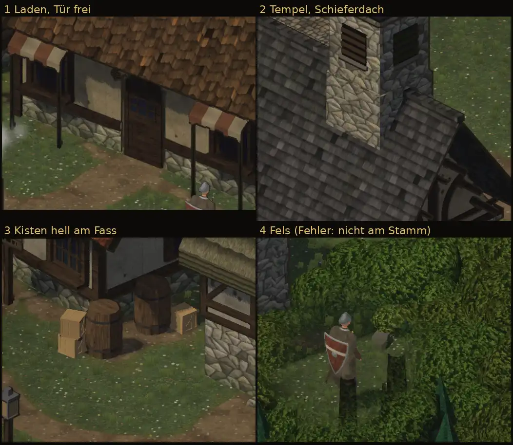

# 348.6 · Dorf: Turmfuß, Markise, Kisten, Felsen (Runde 2) · Tom · 28.10., 03:17

**Ansehen (Morgenblatt):** Dein Wort 00:07 „größere Fehler ausbessern, Dorf fertigmachen und weitere Objekte platzieren“. Ersetzt das Blatt von 01:52 (Runde 1: Blech am Turmfuß wie ein Loch, Stange vor der Tür, Kisten zu dunkel). Runde 2 mit beiden erlaubten Probeläufen (389).

**Gebaut:**
1. Laden: die Markisen links und rechts lassen mehr Platz um die Tür; die Tür ist jetzt auch in der gedrehten Ansicht von Südwest frei (laut Prüfung, nicht im Blatt). Stangen stehen hinter dem Saum.
2. Tempel: **glattes Schieferdach wie im alten Spiel** (dort war die Kirche Schiefer) statt gewellter grauer Ziegel. Auf der glatten Fläche sitzt der Turm mit sauberer Kante, das schwarze Blech ist weg.
3. Kisten in hellem Kiefernholz neben den Fässern, manchmal zwei gestapelt (Dorfbausatz).
4. Versucht, nicht gelungen: Felsen (Naturbausatz) an jedem einzeln stehenden Baum, zur Kamera hin vor dem Stamm; am Waldrand jeder vierte. Ausschnitt 4: die graue Form links neben dem Helden ist der Fels.

## Befund der fremden Prüfung (03:13)

- Laden: Tür in Grundansicht und von Südwest frei, keine Stange im Stoff. Gering: Saum unten leicht treppig.
- Tempel: kein Loch, keine Zacke am Fuß, nichts schwebt. Gering: rechts am Turmfuß ein dunkler Schattenkeil, oben an der Steinstufe ein kurzer heller Strich.
- Kisten: Lichtseite Grauwert 93–117, Fass 49–57, also etwa doppelt so hell. Gering: die hellen Streben könnten wie Kratzer wirken.
- **Felsen, offen (hoch):** in keiner Ansicht klar am Fuß eines Stammes; einer liegt über dem Stammende, einer steht ohne sichtbaren Baum. Das Moos wirkt fast schwarz statt grün (mittel). Nächster Lauf: Lage zum Stamm nachmessen, Moos heller.
- Nicht aus diesem Lauf: wird ein Haus oder eine Krone vor dem Helden durchsichtig, zeigen sich harte dunkle Rechtecke.

**Fragen an dich, wenn du magst:** Schieferdach am Tempel so? Welche weiteren Dinge willst du im Dorf? Vorschlag aus dem Bestand: Efeu an Steinwänden, Kiesel an den Wegrändern (beides ändert nicht, wo man gehen kann); Karren und Zäune bräuchten freie Kacheln auf der Karte.
