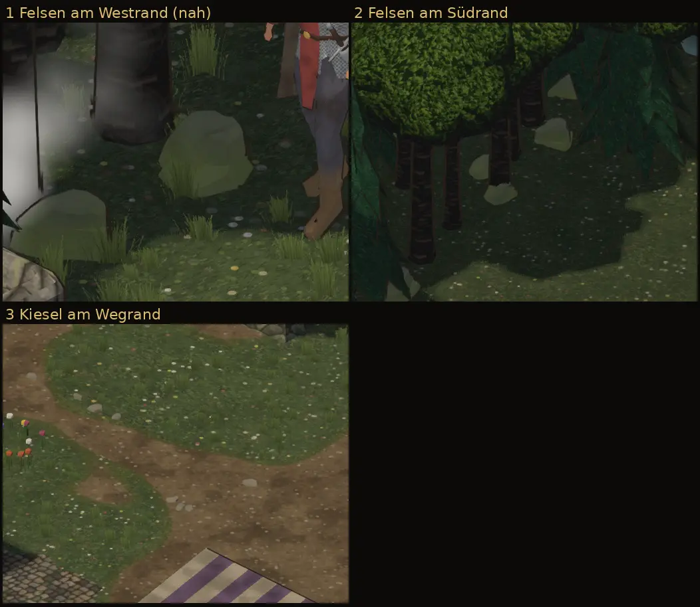

# 348.6 · Dorf: Turmfuß, Markise, Kisten (Runde 2); Felsen, Kiesel (Runde 3) · Tom · 28.10., 04:31

**Ansehen (Morgenblatt):** Dein Wort 00:07 „größere Fehler ausbessern, Dorf fertigmachen und weitere Objekte platzieren“. Ersetzt das Blatt von 01:52 (Runde 1: Blech am Turmfuß wie ein Loch, Stange vor der Tür, Kisten zu dunkel). Runde 2 ging um 03:2x per Telegram an dich; danach gibt das Zählwerk (389) zwei neue Läufe frei, die Runde 3 genutzt hat. Je Runde zwei Läufe. Zweig `claude/tom-348-fundament`.

## Runde 2: Laden, Tempel, Kisten (03:17)

**Gebaut:**
1. Laden: die Markisen links und rechts lassen mehr Platz um die Tür; die Tür ist jetzt auch in der gedrehten Ansicht von Südwest frei (laut Prüfung, nicht im Blatt). Stangen stehen hinter dem Saum.
2. Tempel: **Schieferdach wie im alten Spiel** (dort war die Kirche Schiefer) als ebene Fläche statt gewellter grauer Ziegel; der Turm trifft das Dach so in einer geraden Linie, das schwarze Blech ist weg.
3. Kisten in hellem Kiefernholz neben den Fässern, manchmal zwei gestapelt (Dorfbausatz).
4. Felsen: in Runde 2 misslungen (Ausschnitt 4, die graue Form rechts neben dem Helden); neu in Runde 3.

**Befund der fremden Prüfung (03:13):**
- Laden: Tür in Grundansicht und von Südwest frei, keine Stange im Stoff. Gering: Saum unten leicht treppig.
- Tempel: kein Loch, keine Zacke, nichts schwebt. Mittel (Prüfung des Blatts 04:28): an der rechten Turmseite liegt am Dachansatz ein dunkler, unruhiger Schattenkeil, im Ausschnitt das Auffälligste. Gering: an der Steinstufe ein kurzer heller Strich.
- Kisten: Lichtseite Grauwert 93–117, Fass 49–57, also etwa doppelt so hell. Gering: die hellen Streben könnten wie Kratzer wirken.
- Älterer Fehler, nicht durch diese Runde: wird ein Haus oder eine Krone vor dem Helden durchsichtig, zeigen sich harte dunkle Rechtecke.

## Runde 3: Felsen und Kiesel (04:13)

**Gebaut:**
- Ursache gemessen: in Runde 2 lagen 64 von 72 Felsen hinter Kronen und Dächern, die in der Grundansicht 2 bis 5 m davor stehen. Jetzt prüft das Bauprogramm mit Strahlen zur Kamera, wo am Stamm ein Fels sichtbar wäre, und legt ihn nur dorthin; Felsen an jedem einzeln stehenden Baum und an etwa jedem zweiten im Wald, auch im Waldring außerhalb des Dorfs (111). Moos heller.
- Neu: kleine Kiesel am Rand der Wege zur Wiese (110); sie ändern nicht, wo man gehen kann.
- Das Dorf hat dadurch etwa 55 000 Dreiecke mehr (rund 13 %).
- Efeu nicht: die Efeuteile des Bausatzes sind Blattkarten mit Transparenz, die unsere Materialien nicht zeichnen.

**Befund der fremden Prüfung (04:25):**
- Felsen, Lage: nichts fehlt, schwebt, steckt im Stamm oder steht ohne Baum; von 15 berechneten Lagen 10 gut, 5 halb verdeckt (ein grauer Keil in einer Laublücke).
- **Felsen, Farbe (mittel, offen): sie wirken gelb-oliv bzw. graugrün, im Blatt eher wie Hügel, Büsche oder Lichtflecken als wie Stein**; ohne Tuschelinie. Gering: am Südrand ragen einige als helle Spitzen unter den Tannen hervor.
- Kiesel: flach, nicht schwebend. Gering: Schattenseite fast schwarz wie eine Kerbe, Form facettiert statt rund, einige liegen weiter im Weg.
- Laden, Tempel, Kisten unverändert. Gering: weißer Schornsteinrauch steht am Westrand wie ein Nebelballen vor den Stämmen.

**Fragen an dich, wenn du magst:** Schieferdach am Tempel so? Felsen und Kiesel so, grauer, oder lieber ohne? Welche weiteren Dinge willst du? Karren und Zäune bräuchten freie Kacheln auf der Karte.
