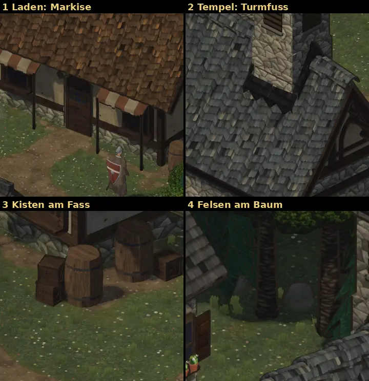

# 348.6 · Dorf: Fehler an den Häusern, erste weitere Dinge · Tom · 28.10., 01:52

**Ansehen (Morgenblatt):** Dein Wort 00:07 „größere Fehler ausbessern, Dorf fertigmachen und weitere Objekte platzieren“. Erste Runde, zwei Läufe.

**Gebaut:**
1. Laden: Markise links und rechts der Tür geteilt, die Tür ist von vorn frei.
2. Tempel: Steinecken statt Holzecken; dunkles Blech um den Fuß des Glockenturms, damit die Ziegel nicht gezackt an den Turm stoßen.
3. Holzkisten neben den drei Fässern, in der Ecke zum Weg, manchmal zwei gestapelt (Dorfbausatz).
4. Felsen am Fuß jeder vierten Baumkachel (Naturbausatz, 376), in Feldsteinfarbe mit Moos.

Bestand geprüft: `LISTE-BESTAND.md`, Dorfbausatz Prop_Crate, Naturbausatz Rock_Medium 1–3 genommen; Pilze wieder heraus (zu klein zu sehen). Dorf 396 491 → 407 657 Dreiecke.

## Befund der fremden Prüfung (01:51), offen

- **Turmfuß misslungen** (hoch): das Blech ist eine schwarze Fläche, unten weiter gezackt, rechts ein schwarzer Keil; wirkt wie ein Loch. Links eine kleine helle Lücke zwischen Dach und Turm. Nächster Lauf: Blech heraus und den Fuß anders lösen.
- **Laden, Ansicht von Westen** (hoch): eine Markisenstange steht dort vor der linken Türkante. Von vorn frei.
- **Felsen in der Grundansicht kaum zu sehen** (mittel): sie liegen meist hinter Stamm oder Krone; sichtbar nach Drehen (Ausschnitt 4).
- **Kisten so dunkel wie Fässer und Balken** (mittel), die linke verschmilzt mit dem Fass.
- Gering: Stangenspitzen ragen in den Stoff; Rauch des Nachbarkamins steigt scheinbar aus einer Markisenstange; Blumen hinter dem First wirken wie darauf.

**Frage an dich, wenn du magst:** Welche weiteren Dinge willst du im Dorf sehen? Mein Vorschlag aus dem Bestand: Karren (Prop_Wagon), Holzzäune, Efeu an Wänden, Kiesel an den Wegrändern.
