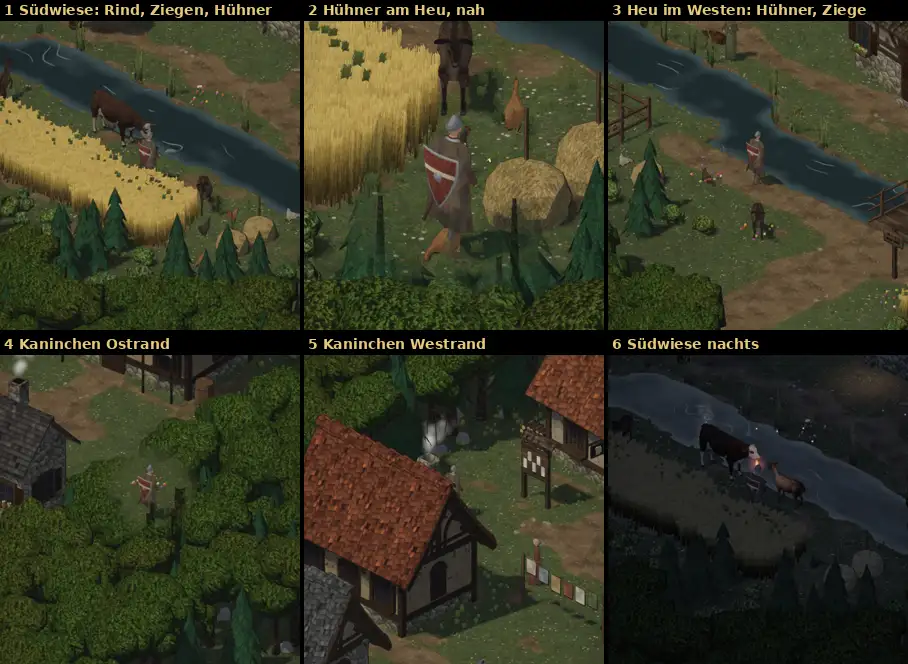

# 348.6 · Dorftiere: Hühner am Heu, Rind und Ziegen auf der Südwiese, Kaninchen am Waldrand · Tom · 28.10., 09:06

**Ansehen:** Du hast um 08:09 gesagt, lieber erst ein paar Tiere ins Dorf zu stellen. Alle Tiere hier sind die gekauften aus 387, so wie Jerry sie heute früh gebaut hat. Der Film (17 s: Wiese, Hühner nah, Westen) liegt in der Telegram-Meldung. Der Film ist dunkler als im Spiel. Für die Helligkeit gelten die Standbilder, sie sind gerechnet wie am Handy.

**Gebaut:**
- **Hühner wie im alten Spiel:** je zwei an jedem Heuballen, zusammen sechs, in drei Farben (braun, hell, schwarz).
- **Neu**, das alte Dorf hatte nur Hühner: ein Rind und drei Ziegen. Rind und zwei Ziegen stehen auf der Wiese südlich des Flusses beim Kornfeld, eine Ziege am Heuballen im Westen. Dazu kommen zwei Kaninchen am Waldrand, eines im Osten, eines im Westen.
- **Verhalten:** Die Tiere bleiben auf Wiese und Blumen, nicht auf Wegen, im Feld oder im Garten. Zwischen den Schritten fressen sie oft: Das Rind grast lange, die Hühner picken häufig.
- **Abstand:** Ein großes Tier wie das Rind hält mehr Abstand zum Helden als ein Huhn.

**Befund der fremden Prüfung (09:04), alles offen:**
- **Hoch:** Beide Kaninchen sind nicht zu sehen. Das östliche steht unter einer Baumkrone, das westliche unter einem Dach. Ich setze sie auf freie Wiese.
- **Hoch:** Der Kopf des Rinds steckt im Kopf des Helden (Bild 1 und 6, Film 0–4 s). Das Rind ist 2,5 m lang, hält aber nur 1 m Abstand. Künftig richtet sich der Abstand nach der Länge.
- **Mittel:** In Bild 2 steht ein Huhn im Stiefel des Helden. Das kam nur bei der Aufnahme zustande, weil ich den Helden genau dorthin gestellt habe, wo das Huhn stand. In Bild 1 steckt der Holzstab, der im Heuballen steht, mitten in einem Huhn.
- **Mittel:** Eine Ziege läuft mit dem halben Körper ins Kornfeld (Film 5–6 s). Ihr Standort liegt am Feld, und der Körper ragt darüber hinaus.
- **Mittel:** Nachts sind die Hühner deutlich dunkler als das Gras und kaum zu sehen. Rind und Ziegen im Fackellicht sind gut zu erkennen.
- **Gering:** In Bild 1 schneidet der Bildrand eine Ziege und ein Huhn an. Von hinten sieht man beim Huhn keine Beine.
- **In Ordnung:** Die Größen passen zum Helden (Rind 1,6 m, Ziege 1,2 m, Huhn etwa 0,6 m). Kein Tier schwebt, keines rutscht über den Boden, keines springt.

**Frage an dich:** Passen die Tiere und ihre Plätze so? Soll noch etwas dazu, zum Beispiel ein Hund oder eine Katze wie im alten Spiel?

**Danach:** Ich behebe die Befunde und lege dir das nächste Blatt vor. Huhn und Kaninchen verbessert Jerry noch (387: Huhn größer und kräftiger braun, Kaninchen mit eigenem Hoppeln), das kommt dann von selbst ins Dorf.
