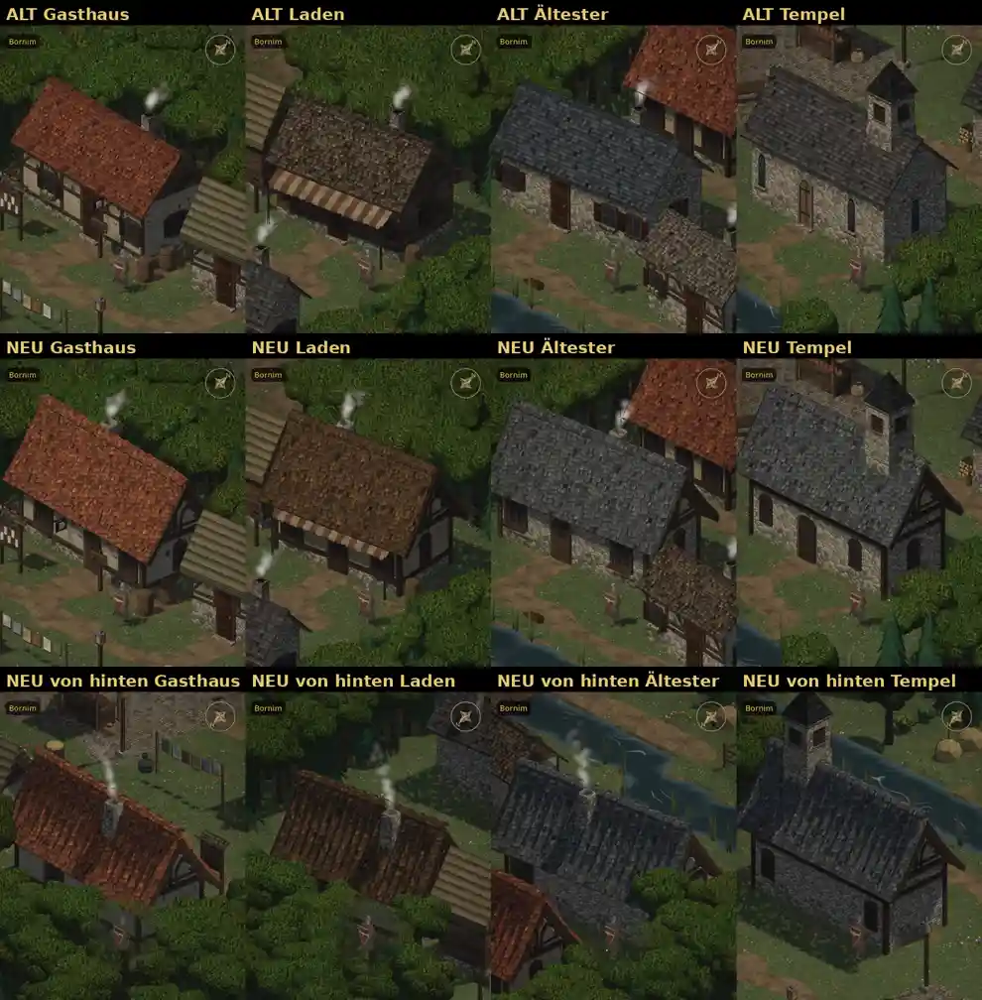

# 348.6 · Häuser mit Innenraum aus dem Bausatz: so weiter?
Tom · 28.10., 00:00 · E Welt
Kurz: Gasthaus, Laden, Ältester, Tempel wie Gwennas Haus aus dem Bausatz, Fenster wie innen: ja oder was anders?

**Dein Auftrag (27.10., 22:14):** „Die anderen Häuser mit Innenraum am bisherigen Raumdesign mit Fenstern ausrichten.“

**Frage:** So weiter (dann gehe ich ans übrige Dorf), oder soll etwas anders sein?

**Votum Tom: ja.** Stärkstes Gegenargument: Mit dem Bausatzdach sind die Häuser höher und kopflastiger als die alten; das Dach fällt mehr auf als die Wände. Bei Gwennas Haus ist das genauso (du hast am 27.10. das Bausatzhaus ohne erhöhte Wand gewählt, 376).

**Gebaut:** Alle vier aus demselben Bausatz wie Gwennas Haus, gleicher Maßstab, gleiche Dachform. Fenster außen dort, wo der alte Raum sie hat: vorn, hinten und am Ostgiebel; am Westgiebel keines, weil der Raum dort keines hat. Die Tür sitzt, wo man hineingeht; der Kamin über der Feuerstelle. Tempel aus Bruchstein, Wände höher als bei den übrigen neuen Häusern, Glockenturm, kein Kamin. Dächer: Gasthaus rot, Laden braun, Ältester und Tempel grau. Gedreht um 3 bis 8 Grad wie alle Häuser im Dorf (376), der Tempel gerade.

**Sichtbar anders als alt:**
- Laden: weißer Putz mit Fachwerk statt dunkler Holzbohlen.
- Gasthaus: Vorderwand fast glatt weiß, Fachwerk nur im Giebel.
- Gasthaus, Ältester: Fensterläden und Blumenkästen fehlen.
- Tempel: kurze Rundbogenfenster statt hoher, schmaler Spitzbögen.

**Befunde der fremden Prüfung, nicht behoben:**
- Die Türen von Gasthaus und Ältestem stoßen oben an die Traufe, wie bei Gwennas Haus. Die Markise des Ladens verdeckt die Tür oben; höher geht sie nicht, sonst stößt sie ans Dach.
- Tempel: Turmfuß auf den Ziegeln gezackt; Holzecken und Fachwerkgiebel wirken wie ein Wohnhaus.
- Die Dächer (am stärksten Laden, Ältester, Tempel; auch Gasthaus) zeigen Streifen, die die Neigung hinablaufen, vor allem von der Seite und von hinten (untere Zeile). Nach deinem Wort (23:52) lasse ich das so.
- Gering: Kaminfüße gezackt; Fuge unter dem First; der Krug am Wirtshausschild liest sich wie Papier; alle Häuser haben denselben Giebel; das Dach des Ältesten verdeckt Gwennas Kamin.
- Im Bild sind die linken Dachenden von Gasthaus, Ältestem und Tempel angeschnitten (Bildausschnitt, nicht das Haus).

**Berührt:** 348.6 (Dorf), 376 (Bausatz, Drehung). Die Innenräume bleiben, wie sie sind.

Antwort: ja, oder was anders
