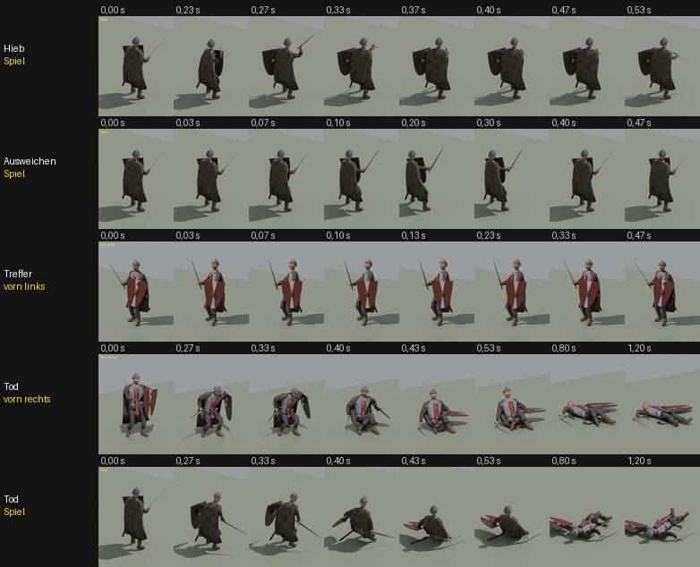

# 348.6 · Kampfbewegungen des Helden, Runde 6 · Tom · 27.10., 12:43

**Ansehen:** [Video](https://github.com/tramour-cmyk/androidapp_rpg_bornim/blob/bilder/pruefung/3486-kampf-r6.mp4) aller acht Kampfbewegungen (Kampfstehen, Ausholen, Hieb, Stich, Treffer, Ausweichen, Abwehr, Tod), je vier Ansichten, „Spiel“ ist die Kampfkamera von hinten rechts; erst Echtzeit, dann vierfach langsam. Das Blatt zeigt Hieb und Ausweichen aus der Spielkamera, Treffer von vorn links, Tod von vorn rechts und aus der Spielkamera. Zweig `claude/tom-348-fundament`, 3a1b26f01.

**Geändert (nur Messbares aus der Prüfung von Runde 5):**
- Hieb: endet mit der Faust vor der Körpermitte, die Klinge nach vorn unten. Vorher endete er links unten; von der Spielkamera lag die Klinge dort 0,37–0,47 s hinter Körper und Umhang.
- Ausweichen: läuft gleichmäßig an und bremst. Vorher begann es mit voller Fahrt, 30 cm im ersten Bild.
- Tod: die Klinge hängt im Einknicken flacher. Vorher lag die Spitze am Boden, während die Faust noch hoch war.

**Fehlerprüfung (fremder Helfer, eine Runde, gemessen):** Die drei Punkte sind behoben. Keine Klinge und kein Schild steckt sichtbar im Körper. Offen:
- hoch: Hieb 0,23→0,27 s: der Körper dreht in einem Bild um etwa 90°, der Schild springt etwa 60 cm. Davor steht die Figur 0,17–0,23 s fast still.
- hoch: Ausweichen: beide Füße gleiten gleichzeitig 45–57 cm seitwärts über den Boden, keiner hebt sich.
- hoch: Tod 0,40→0,43 s: der Kopf fällt in einem Bild etwa 25 cm, der Schild klappt in einem Bild flach. Davor 0,20–0,47 s ruckweise.
- mittel: Treffer: Ruck im ersten Bild (17–22 cm, seit Runde 2 so gewollt), der hintere Fuß schleift 7–13 cm.
- mittel: Tod im Liegen: vom Umhang sind nur dünne Zipfel zu sehen.
- Blatt: im Tod fährt die Kamera ab 0,33 s mit, die Zeile „Spiel“ ist dort keine feste Spielkamera; ab 0,63 s ist der Schild am Rand abgeschnitten.

**Vorschlag:** Bis zu deinem Urteil baut der Nachfolger die Technik: den Sprung im Hieb, das Fußgleiten beim Ausweichen und den Sprung im Tod. Wie es aussieht (Stuhl, Wappenrock wie ein Brett, Umhangzipfel), urteilst du. Runde 7 nur, wenn die Richtung stimmt; sonst ein gekauftes Paket mit Kampfbewegungen prüfen (348.12c). Kopf t78 erst nach deinem Urteil zu 376.1 (gekaufte Figuren), sonst ist er vielleicht umsonst.

**Sag:** „passt“ oder was anders werden soll.
