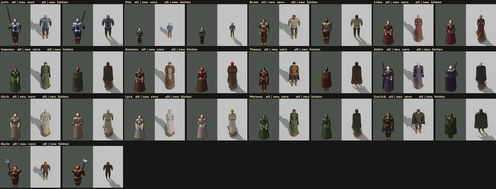

# 348.6 · Leute Entwurf 1 · Tom · 25.10., 16:12

Alle 13 Dorfbewohner grob aus dem Heldenmodell abgeleitet, je alt|neu von vorn, alt|neu von hinten, gleicher Maßstab, noch ohne Tusche. Volles Bild: Zweig `bilder`, `pruefung/348.6-leute-e1.png` (auch auf Telegram).

**Befund Helfer (4 Runden):** Haar wirkt als Kappe; Körper je Gruppe gleich, Statur kaum zu sehen; Pim und Borin nur verkleinerte Erwachsene; Hände klein, Arme leicht abgespreizt; Rocksaum unten braun und links schief; Lyras Reif unsichtbar; Rowenas Schürze starr; Garricks Bart blond (wie im alten Spiel hinterlegt).

**Sag:** „Richtung ja“ (dann Runde 2 mit diesen Punkten und Einbau ins Dorf) oder was anders werden soll.
