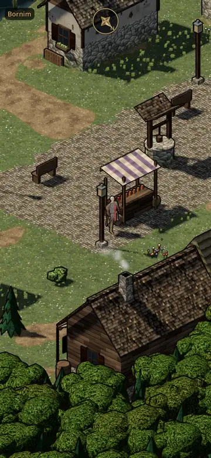

# 348.6 · Windrose in Godot: so richtig?
Tom · 25.10., 10:49 · G Stil · M (Chef 25.10., 08:42, über Sokrates)

## Frage

Ist die Windrose so richtig, wie du sie wolltest? Ja → bleibt so; nein → was stört?

## Empfehlung

Ja.

Am Handy sieht man es besser als im Bild: APK aus dem nächsten grünen Godot-Lauf auf `claude/tom-348-fundament` ([Actions](https://github.com/tramour-cmyk/androidapp_rpg_bornim/actions/workflows/godot.yml), Artefakt `bornim-godot-apk`), Karte mit zwei Fingern drehen, dann auf die Windrose tippen. Die Godot-Fassung hat eine eigene Kennung (`de.bornim.game.godot`) und kommt neben das alte Spiel.

## Berührt

348.6 (Umzug Godot, Dorf).

## Begründung

Du wolltest eine halbtransparente Windrose oben, die sich mit der Karte dreht; Tippen dreht zurück in die Nordausrichtung (Standardansicht).

## Sachverhalt

Im Bild ist die Karte gedreht, darum steht das N rechts unten.

- Oben in der Mitte, halbtransparent, dreht flach mit der Karte; Norden steht in der Standardansicht schräg rechts oben (45°).
- Tippen dreht die Karte zurück in die Standardansicht.
- Gold voll, Scheibe zu 62 % schwarz, gefüllte Spitzen hell und dunkel, das N innerhalb des Rings.

## Auswertung

Drei Prüferrunden; danach rückte das N in den Ring, und ein vierter Prüfer hat dieses Bild geprüft. Es bleibt: Das Gold wirkt eher sandfarben, und die Scheibe wirkt fast deckend, man sieht die Halbtransparenz kaum. Stärkstes Gegenargument: Auf hellem Stroh oder Gras könnte der Ring trotz dunklem Außenrand untergehen; im Bild ist es lesbar.

## Folgerungen

Ja: Runde 8 ist fertig. Nein: eine Runde Nacharbeit nach deinem Wort.
