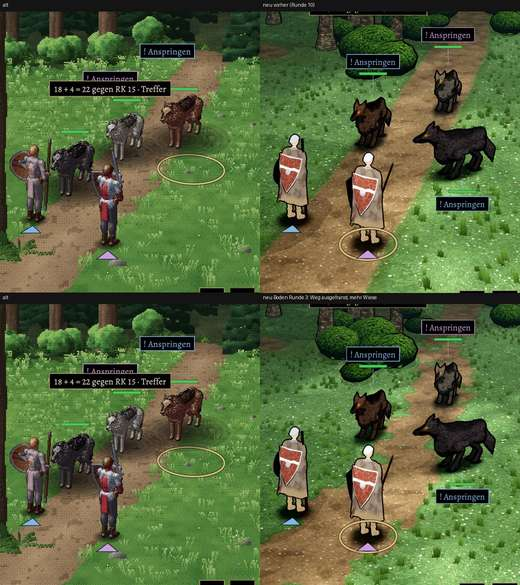

# 348.7 · Kampfort-Boden Runde 3 · Jerry · 25.10., 20:33

Dein Auftrag 19:05: „keine schnurgeraden Wege, sondern das ein bisschen ausfransen. Bisschen mehr richtige Wiese“. Weg geschwungen, Breite schwankt, Rand mit Zungen, Halme in Flecken. Großbild: Telegram 25.10., 20:3x (`bilder:pruefung/348.7-kampfort-boden-r3`).

**Befund (Helfer, Diogenes):** Rand noch „wie ausgeschnitten“, Halme noch recht gleichmäßig; harte diagonale Kante im Weg unten links (vermutlich Kachelnaht der Erde-Textur); 7 % heller als alt; Steine und dunkler Waldrand fehlen; Schatten rund.

**Sag:** „Boden passt“ oder was zuerst geändert werden soll.
