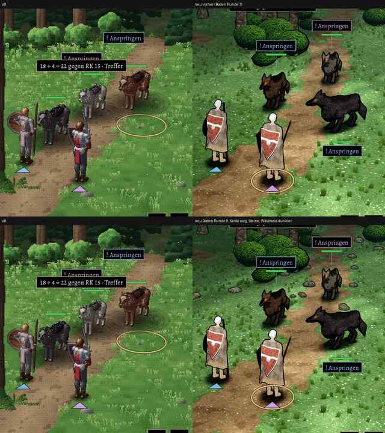

# 348.7 · Kampfort-Boden Runde 6 · Jerry · 25.10., 21:36

Oben alt | neu Runde 3, unten alt | neu Runde 6. Dein Auftrag 21:03: Kante unten links beheben, Steine, dunkler Waldrand. Großbild: Telegram (`bilder:pruefung/348.7-kampfort-boden-r6`).

**Gemacht:** Die Kante war der Schatten der nahen Eiche vorn links, abgeschnitten am Rand des Schattenbereichs (keine Naht im Boden); die Eiche wirft jetzt keinen harten Schatten mehr, ihr weicher Kronenschatten ist in den Boden gemalt. 14 Steingruppen am Weg- und Lichtungsrand. Waldboden und Saum am Rand der Lichtung dunkler.

**Befund (Helfer, 3 Runden):** Kante weg; Steine lesen sich als Steine, noch dünn umrandet, ohne Schatten darunter; Waldrand oben rechts kaum dunkler (71 gegen alt 58), Lichtung insgesamt heller und bunter als alt (98 gegen 93; Messlatte: +3 %, frei); ein Wegrand unten links noch fast gerade; Würfelzeile oben im Ausschnitt angeschnitten (nur das Blatt).

**Sag:** „Boden passt“ oder was zuerst geändert werden soll (Vorschlag: Wiese gedämpfter, Waldrand dichter und dunkler).
