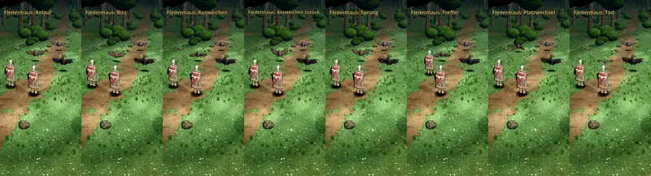

# 348.7 · Riesenfledermaus Runde 5 mit neuer Tusche · Team Jerry · 28.10., 15:17

**Bitte ansehen:** [Film](https://cdn.jsdelivr.net/gh/tramour-cmyk/androidapp_rpg_bornim@bilder/2026-10/28-1517-348.7-Jerry.mp4) (Telegram 28.10., 15:17), 20 s, im Kampfort im Wald:
- 0,3 s Anlauf, 2,5 s Biss, 4,5 s Ausweichen, 8,0 s zurück, 11,4 s Sprung, 14,0 s Treffer, 15,6 s Platzwechsel, 17,6 s Tod.

**Geändert (deine Frage 10:06 „gleichmäßiger Tuscherand?“):** Das Modell ist wie in Runde 4d. Die Tusche ist jetzt die neue, nach dem Licht (348.13a, Linie 1,3), nicht mehr der gleichmäßige Rand.

**Sag:** „348.7 Fledermaus passt“ oder was nicht stimmt.

Der Befund des fremden Prüfers kommt nach dem Senden als Text (Archiv 396).
