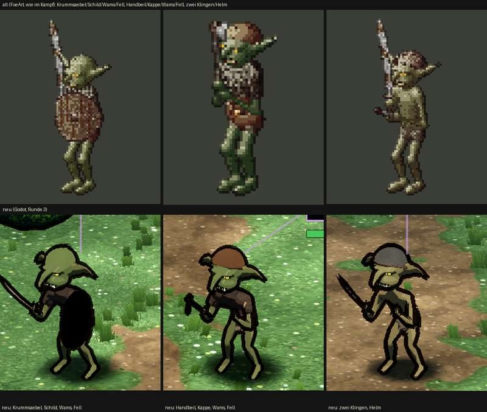

# 348.7 · Goblin Runde 3 · Jerry · 25.10., 21:03

Oben alt (gezeichnet), unten neu (Godot): Krummsäbel, Schild, Wams, Fell · Handbeil, Kappe · zwei Klingen, Helm. Neu: geduckte Lauer, Kopf größer, Hängeohren, längere Nase, Haut dunkler, Waffen kleiner. Großbild und ganzes Kampfbild: Telegram 25.10., 21:0x (`bilder:pruefung/348.7-goblin-r3`, `-1`).

**Befund (Helfer, Homer, Diogenes):** wirkt drollig, nicht gefährlich (großer runder Kopf, Hängeohren, weiche lange Nase wie ein Rüssel, Punktaugen, dicke Kontur); die drei Körper sind gleich, nur die Ausrüstung wechselt; die freie Hand von Beil- und Helm-Goblin hängt vorn auf Schritthöhe, der Dolch ist kaum zu sehen; der Schild liest sich von vorn als schwarzes Oval; Fell, Finger und Zehen fehlen; zwei Goblins fast gleiche Haut; Helm matt, Beil liest sich als Hammer, Knubbel am Hinterkopf (fernes Ohr), heller Strich auf der Nase (Narbe); kein Name über den Goblins, „Goblin 1/2/3“ in der Zugleiste keiner Figur zuzuordnen; Ansage „Stich“ auch bei Säbel und Beil, eine Kopfhöhe über dem Goblin. Helligkeit nicht messbar (alt vor einfarbigem Grund, neu im Gras). Gut laut Homer: Umriss im Kampfbild und Farben oliv/braun.

**Vorschlag für Runde 4 (Homer):** Ohren spitz und waagerecht nach hinten; Unterbiss mit zwei hellen Hauern, Nase kürzer als Haken; Brauenwulst mit tief liegenden Augen, Kopf kleiner, Kopf vorgeschoben; verschlagene Miene. Dazu: Hände vor die Brust, Schild mit Rand und Buckel, drei Haltungen.

**Sag:** „Runde 4 so“ oder was anders werden soll.
