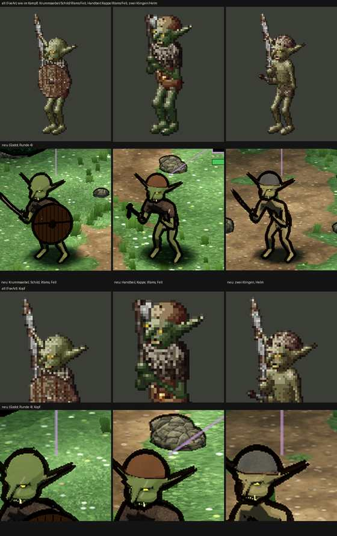

# 348.7 · Goblin Runde 4 · Jerry · 25.10., 22:05

Oben alt (gezeichnet) und neu (Godot), darunter die Köpfe vergrößert, alt über neu. Dein Wort 21:12: Kopf nach der Vorlage; 21:33: „wie Dobbi“, Schild „so schwarz“. Großbild und ganzes Kampfbild: Telegram (`bilder:pruefung/348.7-goblin-r4`, `-1`, `-2`).

**Gemacht:** Kopf mit den Zahlen der Vorlage (`Doll.kt` :882): gerechnet 4,2 Köpfe statt 3,6, Ohren seitlich hoch und spitz nach hinten statt hängend, Nase kürzer mit Spitze nach unten statt Rüssel, schmale gelbe Schlitzaugen statt Punktaugen, Hauer vor der Lippe, Zähne gelber. Schild aus Brettern mit Fugen und Eisenband, halb zum Gegner gedreht; vorher lag die Vorderseite im eigenen Schatten.

**Befund (Helfer, drei Fassungen):** Der Kopf trifft die Vorlage noch nicht: der Schädel ist eine hohe, glatte Kuppel und wirkt wie ein Drittel der Körperhöhe, der Eindruck „wie Dobbi“ bleibt in Spielgröße. Brauenwulst nur als dunkle Kante, die Augen liegen nicht im Schatten. Beide Ohren stabdünn ohne Blattfläche, das hintere liest sich wie ein Fühler. Nase ohne Haken. Kiefer schmal ohne Unterbiss; nur ein Hauer sichtbar und zu klein, das Maul ist in Spielgröße nicht lesbar. Schild jetzt braun mit Fugen, Band und Buckel, aber noch recht dunkel, eher glattes Rund als rohe Bretter, Rand nur als Umrisslinie; die Faust stach durch den Schild, behoben bis auf einen Punkt von 1–2 Bildpunkten. Waffen schwarz ohne Metall, das Beil wirkt wie eine Keule, beim dritten Goblin ist nur eine Klinge erkennbar. Farben heller und einheitlicher als alt (das Dunkelgrün des zweiten fehlt, Helm grau statt braun), dicke schwarze Umrisse, die alt nicht hat. Ansagelinien laufen durch die Köpfe.

**Diogenes:** Maß unverwertbar wie Runde 3; Schild erfüllt; Kopf nicht 1:1 (Kuppel, Ohren waagerecht, Hauer winzig); Rest wie Runde 3.

**Sag:** „Runde 5 so“ (Vorschlag: Schädel flacher und vorgeschoben, Brauenwulst, Kiefer breiter mit Unterbiss, zwei große Hauer, Klingen hell) oder was zuerst. Ab Runde 5 gilt die Abnahmeliste 348.11, sobald du sie billigst.
