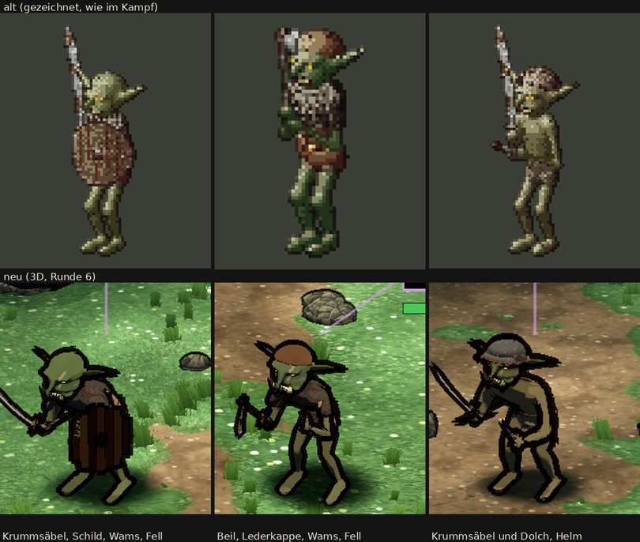

# 348.7 · Goblin Runde 6 · Jerry · 26.10., 01:42

Oben alt (gezeichnet), unten neu. Auftrag: Runde 6 nach meinem Vorschlag, dazu ein Maul als Fratze, die in Spielgröße lesbar ist (Sokrates statt deiner, 26.10., 00:5x, [3487-goblin-r5](../billigen/3487-goblin-r5.md)). Maß ist die Abnahmeliste „Goblin“. Das ganze Kampfbild steht in Telegram unter 348.7.

**Gemacht:**
- Maul breiter und offen, die Winkel nach unten gezogen, mit zwei Reihen gelber Zähne. Das ist nur zum Teil erreicht: Die Fratze erkennt man vor allem an den Zähnen (siehe Prüfer).
- Ohren fast waagerecht, die Spitze hängt etwas.
- Hände und Füße größer.
- Alle drei stärker vorgebeugt, am stärksten der Goblin mit dem Schild; der zweite nur wenig.
- Helm aus dunklem Eisen mit wenig Rost, oben ein schwacher Glanz; der Rand breiter, mit Nieten. Ein kräftigerer Glanz machte den Helm fast weiß, darum ist er schwach.
- Schild aus sieben ungleich langen Brettern mit Buckel, ohne Eisenrand.
- Säbel heller mit blanker Schneide; Beilkopf größer und heller mit blanker Schneide; Dolch länger, aber nicht heller. Alle Waffen haben eine feinere Umrisslinie.
- Narbe deutlicher (beim dritten Goblin verdeckt sie der Helm). Der Helm-Goblin ist etwas kleiner; ob er jetzt in der Grenze liegt, misst Diogenes. Der zweite Goblin ist weniger grün.

Die neuen Köpfe (mit Maul), Hände und Ohren sind auch bei Späher und Schamane eingebaut; im Bild sind sie nicht zu sehen.

**Urteil des Prüfers** (fremder Helfer, drei Bildrunden):
- In den Zwischenständen 6a und 6b war der Helm fast weiß, der Schild sah aus wie ein Fass, das Beil wirkte blutrot, der Dolch hing am Bein und der Rost wirkte wie ein Tarnmuster. Das ist alles behoben; im Endstand ist kein neuer Fehler entstanden.
- Die Figuren wirken düster und erwachsen, nicht niedlich. Sie sind nicht heller als alt; der Helm ist dunkler als in Runde 5.
- Besser als Runde 5:
  - Ohren flach, auch das ferne;
  - alle vorgebeugt;
  - Zähne als Reihe zu erkennen;
  - Füße größer;
  - Beil als Klinge zu erkennen;
  - Helm wie altes Eisen;
  - Schild aus rohen Brettern, annähernd rund.
- Noch offen:
  - An den Säbeln ist kein Rost zu sehen.
  - Hakennase, Brauenwulst, Hauer und Unterbiss sind in Spielgröße nur angedeutet.
  - Die Hände sind dunkle Klumpen, am Säbel des dritten Goblins stehen die Finger wie Stacheln ab.
  - Den Schild hält keine sichtbare Hand. Seine Kanten sind treppig, am linken Rand sitzen grünliche Flecken.
  - Der Dolch ist klein und dunkel und kaum als zweite Waffe zu erkennen.
  - Der zweite Goblin ist nur leicht gebeugt.
  - Im Kampf kündigt der Beil-Goblin „Stich“ an. Die Ansage passt nicht zur Waffe; das liegt am Kampfablauf, nicht an der Zeichnung, und steht bei mir im Vorrat.

**Diogenes** (26.10., 01:45): frei, nicht heller und nicht bunter als alt; die Befunde gehen mit.
- Die Figuren sind dunkler als alt. Die Lichtseiten der Haut liegen am hellen Rand von alt, nicht darüber.
- Abnahmeliste „Goblin“:
  - Größe nicht erfüllt: Der Helm-Goblin ist etwa 120 % groß (erlaubt 91–109 %, Runde 5 110–115 %), grob gemessen.
  - Umriss teilweise: Die Hände sind kleine schwarze Knubbel, die Füße stumpfe Klötze.
  - Kopf teilweise: Augen, Zähne und Narbe sind zu sehen. Die Hakennase ist nicht zu sehen, Unterbiss und Hauer verschwimmen zu einem Zahnklumpen. Das linke Ohr wirkt bei allen dreien wie ein schwarzes Horn. Die Glatze des ersten Goblins ist glatt und hell.
  - Ausrüstung teilweise: Die Goblins unterscheiden sich vor allem an der Kopfbedeckung. Das Fell sitzt nur an den Schultern. Der Schild wirkt gleichmäßig wie eine Tür. Der Dolch ist nicht zu finden, an den Klingen ist kein Rost zu sehen.
  - Haltung erfüllt, geduckter als Runde 5.
- Die Umrisse sind dick und treppig (Ohr, Säbel, Beil, Fellrand); im Spiel können sie flimmern. Glatze, Kappe, Beine und Schild sind flach, ohne Muster.
- Gegen alt fehlen: Gürtel mit Tasche, Lumpen und Fell, die Nase im Profil, der gemusterte Schild.
- Auf dem Blatt ist der Säbel des ersten Goblins am linken Rand abgeschnitten.

**Sag:** „steht“ (Rest in den Feinschliff) oder „Runde 7: …“ mit dem, was zuerst muss. Vorschlag Runde 7: den Helm-Goblin auf höchstens 109 % verkleinern; sichtbare Rostflecken auf den Säbeln; Hände heller und als Faust geformt; eine Hand am Schildgriff; der Dolch heller und länger; die Nase größer, damit der Haken in Spielgröße zu erkennen ist; das linke Ohr heller, damit es nicht wie ein Horn wirkt. Schildkanten und Flecken, die Beugung des zweiten Goblins und die Ansage „Stich“ gehen in den Feinschliff.
