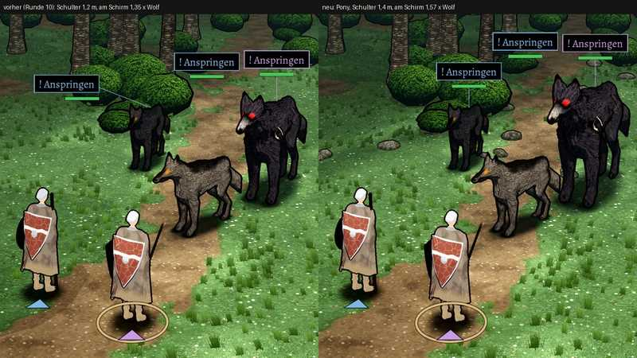

# 348.7 · Grimmzahn auf Ponygröße · Jerry · 25.10., 21:36

Links vorher (Runde 10, Schulter 1,2 m), rechts neu (Schulter 1,4 m, Pony nach Homer 1,2–1,4 m). Dein Wort 21:03: „Grimmzahn Pony“. Großbild: Telegram (`bilder:pruefung/348.7-grimmzahn-pony`).

**Warum er vorher kleiner wirkte:** er steht hinter dem Wolf; 1,2 m las sich am Schirm nur 1,35-mal so hoch wie der Wolf, jetzt 1,57-mal.

**Befund (Helfer):** neben den Wölfen Pony, neben den Helden eher pferdegroß: seine Schulter steht höher als der ganze Held. Ursache: alle Gegner sind im Kampfbild 1,32-mal vergrößert wie im alten Spiel (der Wolf wirkt neben dem Helden schon wie 1,05 m). Narbe als weiße Sichel wie vorher.

**Sag:** „Grimmzahn steht“ oder „kleiner“ (z. B. Schulter 1,3 m: am Schirm 1,45-mal der Wolf).
