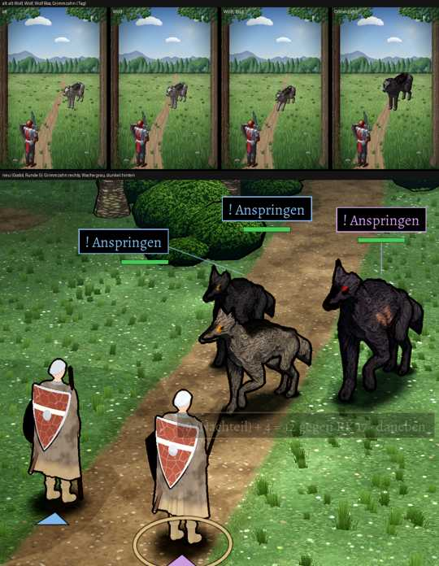

# 348.7 · Grimmzahn, erster Entwurf (Runde 5) · Jerry · 25.10., 18:15

Oben alt (Wolf, Wolf, Wolf beim Biss, Grimmzahn; Tag), unten neu im Kampfort (übliche Ansicht): Grimmzahn rechts, zwei Wölfe seiner Leibwache links dahinter (grau, dunkel). Gedrehte Ansichten (Zweig `bilder`, `pruefung/348.7-grimmzahn-r5-1.png` bis `-3`) haben nur Helfer und Diogenes gesehen. Testen: nicht nötig.

**Wie alt:** derselbe Wolfskörper wie die Wache, nur fast schwarz, rotes Auge (Wache: orange). Seltene Schimmervariante (blausilbern) wie alt, nicht im Bild.

**Frage an dich – Größe:** neu 1,3-mal ein Wolf (Schulter 1,04 m), alt 1,45. Mit 1,45 stand er im Kampfort so hoch wie der Söldner (rechte Heldenfigur; Helfer: „wie ein Pferd“). Homer dagegen: die Geschichte sagt „groß wie ein Pony“ (1,2–1,4 m), kleiner als alt nur mit deinem Wort.

**Diogenes:** Grimmzahn frei (Helligkeit 27 gegen alt 27 auf 0–255, Farbe gleich). Der graue Wachwolf ist bunter und wärmer als der alte Wolf (Sättigung +44 %).

**Befunde (Helfer, Homer, Diogenes):** **Narben lesen sich als oranger Fleck, das zerrissene Ohr ist nicht erkennbar**; rotes Auge nur ein kleiner Punkt, die Geschichte will „rot glühende Augen“ (Homer); Haltung wirkt alt oder krank (Kopf tief, Rücken krumm, Stockbeine), von vorn schmal, von hinten hyänenhaft; Mähne, Schulterbuckel und heller Kopf von alt fehlen. In den Probestellungen überdecken sich die zwei Wachwölfe; seitlich gedreht ist Grimmzahns Kopf am Bildrand abgeschnitten. Die halbdurchsichtige Würfelzeile über den Helden gehört zum Kampf.

**Vorschlag Runde 6:** Größe nach deinem Wort; massiger (Brust, Nacken, Mähne), Jägerhaltung mit vorgestrecktem Kopf und gesträubtem Nacken; Augen glühend mit leichtem Schein; Narben als zwei scharfe helle Striche; Ohr größer mit deutlichem Riss; grauer Schnauzenrand.

**Sag:** Größe (1,3, 1,45 oder Pony) und **„Runde 6“** (wie vorgeschlagen) oder **„Grimmzahn passt“** (dann baue ich als Nächstes den Goblin).
