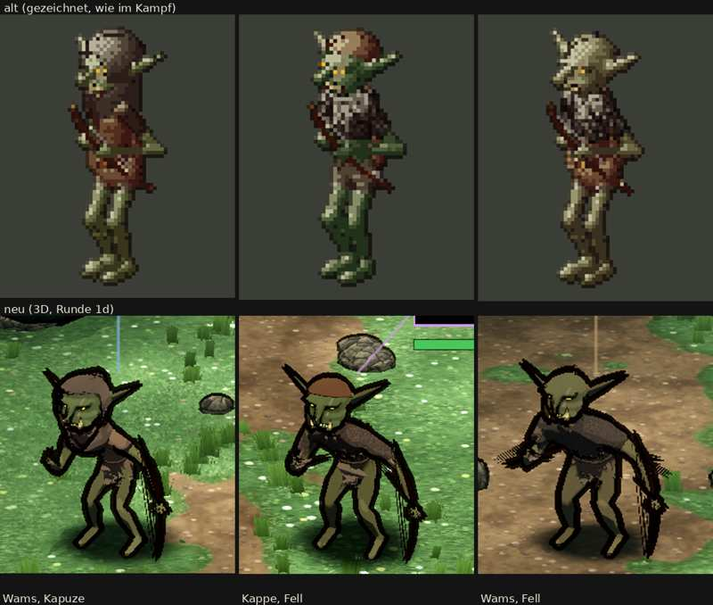

# 348.7 · Goblin-Späher Runde 1 · Jerry · 26.10., 00:46

Oben alt (gezeichnet), unten neu. Maß ist die Abnahmeliste „Goblin-Späher“ (`LISTE-FIGUREN.md`). Körper und Kopf wie Goblin Runde 5 (dein Urteil dazu steht noch aus). Ganzes Kampfbild in Telegram unter 348.7.

**Gemacht:** drei Ausrüstungen wie im alten Spiel: Lederwams und Kapuze (Kapuze vorn offen, Zipfel hinten, Kragen bis auf die Schultern); Lederkappe und Fellumhang; Lederwams und Fellumhang (Fell mit Zotten am Saum). Kurzbogen in der linken Faust, Sehne zum Körper, ohne schwarze Umrisslinie, damit das Holz zu sehen ist. Rechte Hand frei.

**Urteil des Prüfers** (fremder Helfer, drei Bildrunden und der Endstand):
- Erfüllt: Größe (soweit prüfbar), Umriss, Goblinkopf, Haut, geduckt; Gesichter grimmig, Augen matt. Bogen jetzt mit Krümmung, Holz und Sehne zu sehen, nicht mehr durchs Bein. Die Kapuze liest sich eher als Kapuze.
- Nicht erfüllt: Die Faust sitzt im unteren Drittel des Bogens statt in der Mitte; der Bogen steht schräg vom Körper weg, statt aufrecht mit dem oberen Ende zum Gegner; er reicht von der Schulter bis auf Fußhöhe, für einen Kurzbogen groß; in Spielgröße erkennt man ihn erst auf den zweiten Blick. Die drei unterscheiden sich am Umriss nur am Kopf, das Fell liest sich als Oberteil. Die Ohren stechen durch die Kapuze, den Zipfel hinten verwechselt man mit Ohr oder Horn. Die Kappe wirkt wie ein Topfschnitt (dieselbe wie beim Goblin). Schwarze Splitter an der rechten Hand des mittleren, frei schwebende schwarze Fransen an Hand und Hüfte des hinteren Spähers; gelbe Krümel an der Bogenhand aller drei. Im ganzen Bild wirken Gras und dicke Umrisse heller und weniger düster als alt (betrifft den Kampfort, nicht die Späher). Der hintere Späher blickt nach links.
- Probiert und verworfen: ein Pfeil in der rechten Hand las sich als Stock.

**Messung** (nur das Blatt, oben gegen unten): mittlere Helligkeit alt 76, neu 75 (von 255), Farbsättigung alt 33 %, neu 31 %: die Späher sind nicht heller, nicht bunter.

**Sag:** „Runde 2: …“ mit dem, was zuerst muss, oder „steht“ (Rest in den Feinschliff). Vorschlag Runde 2: Bogen in der Mitte gefasst und aufrecht neben dem Körper; Fellumhang mit breitem Kragen, damit er den Umriss ändert; Ohren durch Schlitze in der Kapuze (flach angelegt würde der Goblinkopf anders); Splitter an der Hand suchen und beheben.
