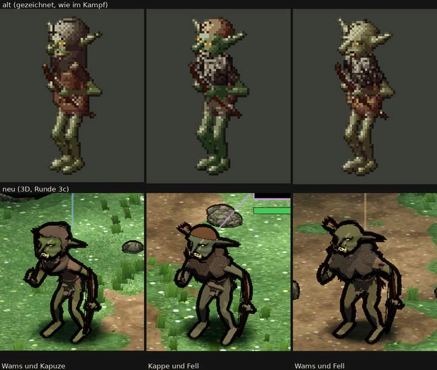

# 348.7 · Goblin-Späher Runde 3 · Jerry · 26.10., 03:26

Oben alt (gezeichnet), unten neu: links Wams und Kapuze, Mitte Kappe und Fellkragen, rechts Wams und Fellkragen. „3c“ im Bild heißt: dritter Anlauf innerhalb von Runde 3. Auftrag: Runde 3 eng, von Sokrates an deiner Stelle entschieden ([3487-spaeher-r2](../billigen/3487-spaeher-r2.md)): (a) Fäuste wie beim Goblin, nichts Gestreiftes an der Hand; (b) Bogen neben dem Bein, beide Wurfarme gekrümmt, ohne Streifen. Bestätigen Prüfer und Diogenes beides bei allen drei, steht der Späher ohne Vorlage. **Das ist nicht erreicht, darum diese Vorlage.** Die farbigen Striche über den Köpfen gehören zur Kampfanzeige, nicht zum Modell.

**Gemacht (drei Anläufe):**
- Hände als geschlossene Faust; Lendentuch und Fell bewegen sich nicht mehr mit dem Arm (das war die Ursache der Stränge an Hüfte und Hand).
- Bogen neben das Bein gesetzt, oben 8° vom Körper weg geneigt; unterer Wurfarm schmaler, schräg, endet über dem Boden statt als Balken bis zum Boden.

**Urteil der Prüfer** (zwei fremde Helfer, Stand 3c, der zweite mit Prüfung dieser Vorlage):
- (a) Faust: bei keinem sicher. Erster Prüfer: Mitte glatt; zweiter Prüfer: auch dort in der Vergrößerung ein heller zackiger Fleck in der Bogenhand. Links: obere Kante treppig, heller gewellter Streifen auf den Fingern, Borstenrand nur schwächer. Rechts: helle zackige Flecken in der Faust (neu, schlechter als 3b), dunkle Fellzacken vom Fellkragen über dem Handgelenk. Auch die freien Fäuste haben helle zackige Fingerkanten, am stärksten links.
- (b) Bogen: bei keinem. Der obere Wurfarm liegt bei allen dreien auf dem Unterarm und steckt im Ellbogen; der untere ist gerade.
- Besser als 3b: unterer Wurfarm kein Balken mehr, Stränge an der Hüfte rechts kürzer, oberer Wurfarm als Bogen etwas lesbarer.
- Noch offen:
  - Dicker, zackiger schwarzer Rand um Fellkragen und Schultern, rechts am stärksten.
  - Die Sehne steht als dünner senkrechter Strich zwischen Bein und Arm und liest sich als Streifen.
  - Mitte und rechts: die Pfeilfedern ragen über den Kopf wie ein roter Stachelbüschel oder ein Horn; ein Köcher ist nicht zu erkennen.
  - Links und Mitte: kleine dunkle Fransen an der Hüftkante.
  - Mitte und rechts unterscheiden sich am Umriss nur an der Kappe (gleicher Fellkragen).
  - Die Liste verlangt einen Fellumhang; von vorn sieht man nur einen Fellkragen wie eine Weste, rechts deckt er das Wams fast ganz.
- Erfüllt: Umriss nach der Liste (großer Kopf, kurze Beine, lange Arme, große Hände und Füße), geduckt; im ganzen Kampfbild (Telegram unter 348.7) kleiner als die Helden, die dort weiter vorn stehen (nur grob vergleichbar).

**Diogenes** (Stand 3c, 03:29): frei, mit Befunden: Gesicht dunkler als alt (−22 bis −35 %), Sättigung +19 / −14 / +11 %. Bedingung (a): Faust ja, die Bogenhand ein Klumpen; (b): Bogen neben dem Bein ja, unterer Wurfarm gerade, heller Längsstreifen oben. Dazu: Hakennase nicht erkennbar; Mitte und rechts nur an der Kappe verschieden. „Frei“ heißt bei Diogenes nur: nicht heller und nicht bunter als alt. Auch nach seinen Befunden ist (b) nicht erfüllt und (a) nur mit Einschränkung; beide Bedingungen sind also bei keinem der drei bestätigt.

**Sag:** „steht“ (Rest in den Feinschliff) oder „Runde 4: …“. Mein Vorschlag: **Runde 4 nur für den Bogen** und die beiden Fäuste. Der obere Wurfarm liegt nach drei Anläufen noch auf dem Arm, weil der Bogen in der Faust hängt und der Arm vor dem Körper liegt; Neigen allein reicht nicht. Vor dem Bau stelle ich im Bild nach, wo Arm und Wurfarm sich schneiden, und setze dann entweder den Bogen weiter nach außen in die Hand oder den Arm gestreckter neben den Körper. Feinschliff (Sehne, Köcher, Umhang, Kappe Mitte) erst danach. Dagegen: auf Kampfbildgröße sieht man den Bogen kaum; wer das genügen lässt, sagt „steht“.
