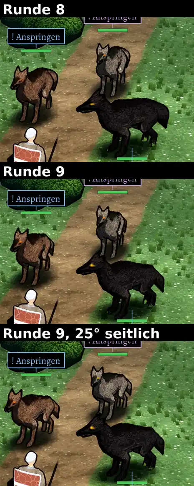

# 348.7 · Wölfe im Kampfort Godot, Runden 8 bis 10: Kopf so richtig, und sollen die Wölfe etwas seitlicher stehen?
Jerry · 25.10., 10:58, Nachtrag 11:38 · Kampf · M (Chef 25.10., 08:57, Urteil zu den Wölfen; Stand 10:06 „liest sich noch nicht als Wolf“)

## Frage

1. Liest sich der Kopf der Wölfe jetzt als Wolf (Runde 8)? Ja → so lassen; nein → was stört am meisten?
2. Der graue und der braune Wolf zeigen hinter dem Kopf weiter eine runde Kuppe (beim braunen schwächer, beim grauen kaum verändert). Sollen die Wölfe in Ruhe etwas mehr seitlich stehen (wie der schwarze, bei dem die Kuppe fehlt), oder bleiben sie dem Gegner zugewandt, und ich forme den Rumpf weiter um? **Antwort: „seitlich“ oder „zugewandt“.**

## Empfehlung

1. Am Bild entscheiden; wer die Bewegungen (Scharren, Biss) sehen will: am Handy, APK aus **Lauf 49** ([Actions](https://github.com/tramour-cmyk/androidapp_rpg_bornim/actions/runs/40182609319), Artefakt unten auf der Seite); er enthält Runde 8 und 9.
2. **Seitlich**, etwa 25° statt 12° vom Gegner weg; der Kopf blickt weiter zum Gegner (Bild unten). Gedreht sind alle drei; der schwarze ändert sich kaum, weil er schon schräg steht. Laut Prüfer hilft das klar beim braunen Wolf (Rücken fast waagrecht), beim grauen weniger: über der Hüfte bleibt eine leichte Kuppe, die forme ich danach nach.

## Berührt

348.7 (Kampfort Godot), 217 (Wölfe beißen in die Luft), 296.3 (Schmuck).

## Begründung

Zu 2: Die Kamera sieht die Wölfe schräg von oben und fast von vorn. Aus diesem Winkel liegt alles, was hinter dem Kopf ist, im Bild höher als der Kopf; auch ein echter Wolf zeigt so seinen Rücken. Nach Runde 9 ist das Hinterteil schmaler, aber die Kuppe ist noch da. Wird der Rumpf weiter abgeflacht, sieht der Wolf von der Seite (Sprung, Biss, Sturz) flach wie ein Brett aus. Der schwarze Wolf steht schon schräger und liest sich laut Prüfer am ehesten als Wolf.

Stärkstes Gegenargument: Um 08:57 hast du gesagt, die Wölfe sollen sich nicht vom Gegner wegdrehen („wo die hinlaufen wollen, weg wahrscheinlich“). 25° sind mehr als jetzt (12°), aber weit weniger als vor deinem Urteil (35°). Laut Prüfer liegt der braune Wolf im unteren Feld schon quer und schaut mit der Schnauze am Helden vorbei; er kann wirken, als wolle er weglaufen.

## Sachverhalt

Das Bild zeigt nur die Ruhe; Scharren und Biss sieht man im APK.

Runde 8 (Kopf):
- Die Schnauze läuft ohne Knolle vom Schädel zur Nase.
- Der Unterkiefer öffnet nach unten, in Ruhe ist das Maul zu.
- Zahnfarbe nur vorn, die hellen Streifen an den Oberschenkeln sind weg, der Lebensbalken sitzt über den Ohrspitzen.

Runde 9 (Hinterteil):
- Die Kuppe kam von Becken und Hinterbeinen, die so breit waren wie die Brust. Das Hinterteil ist jetzt etwa halb so breit wie die Brust und oben flacher.
- Danach bildete die buschige Rute die Kuppe. Darum sitzt sie jetzt tiefer, hängt steiler und ist dünner.

## Auswertung

Befunde des Prüfers (fremder Helfer, drei Runden zu Runde 9), noch offen:
- Grauer und brauner Wolf: Die Kuppe ist nicht weg (beim braunen schwächer, beim grauen kaum verändert). Sie kommt jetzt aus Becken und Rücken, nicht mehr aus der Rute.
- Schwarzer Wolf: klar besser. Die Rute ist ein buschiger Keil, die Rückenlinie wie beim Wolf.
- Grauer Wolf: Die Rute wirkt in Ruhe eher wie ein dünner Strick als buschig; beim braunen ist sie ein spitzer Zipfel.
- Scharren: Das gehobene Vorderbein des braunen Wolfs endet als runder Klumpen.
- Biss: Beim braunen Wolf sieht man die Hinterbeine zwischen den Vorderbeinen; gedreht (unteres Feld) wirken beim grauen und braunen die Beine hintereinander wie fünf bis sechs.
- Das Schild „! Anspringen“ über dem grauen Wolf ist im Bild vom Rand abgeschnitten (nur der Ausschnitt).
- Aus Runde 8 noch offen:
  - am Kieferrand ein heller Streifen, beim Biss kein dunkler Rachen;
  - die Schnauze des schwarzen Wolfs eher zu lang, die Ohren des grauen und braunen groß wie beim Fuchs;
  - ein heller Fleck am Oberschenkel (dort fällt das meiste Licht hin).

## Nachtrag Runde 10 (11:38)

Die beiden Fragen oben bleiben gleich; Runde 10 ändert nur Teile, die nicht davon abhängen.

- **Scharren:** Der Vorderlauf, der zur Kamera zeigt, hebt sich, greift nach vorn, setzt auf und zieht über den Boden zurück. Vorher klappte der andere Lauf unter die Brust und las sich als Klumpen. Laut Prüfer (drei neue Runden) liest es sich beim schwarzen Wolf klar als Scharren, beim braunen nur das Heben, beim grauen sieht man fast keine Bewegung. Beim braunen wirkt der andere Vorderlauf dabei zu lang.
- **Rute:** wieder etwas dicker. Beim schwarzen buschig, beim grauen weiter schmal, beim braunen eher breit und flach. Ein Bild mit eingefärbten Körperteilen zeigt: Die Kuppe hinter dem Kopf kommt nicht von der Rute, sondern vom Rücken zwischen Brust und Becken. Die Vermutung aus Runde 9 ist damit überholt; die Kuppe bleibt Frage 2.
- **Neu gefunden:** Im Bild steht der graue Wolf mit den Vorderpfoten auf dem Ohr des schwarzen, man sieht nicht, wer vorn steht. Ursache: die beiden stehen fast hintereinander. Mehr seitlicher Abstand half nicht und ist zurückgenommen; ich stelle sie als Nächstes weiter auseinander nach hinten und vorn.
- Biss (braun, Hinterbeine zwischen den Vorderbeinen) ist noch nicht angefasst.
- Runde 10 ist noch nicht im APK von Lauf 49; der Link zum neuen Lauf folgt hier.

## Folgerungen

- 1 ja, 2 seitlich: 25° Drehung, danach Rücken des grauen Wolfs, Scharren beim grauen und braunen, Abstand grau/schwarz.
- 2 zugewandt: den Rücken hinter der Schulter tiefer legen; Gefahr, dass die Seitenansicht flach wird; Scharren und Abstand ebenso.
- 1 nein: ein Satz, was am Kopf am meisten stört.
