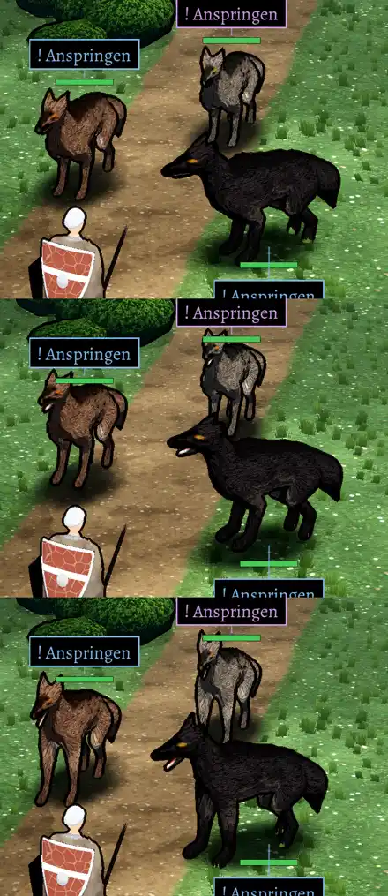

# 348.7 · Wölfe im Kampfort Godot, Runde 8: liest sich der Kopf jetzt als Wolf?
Jerry · 25.10., 10:33 · Kampf · M (Chef 25.10., 08:57, Urteil zu den Wölfen; Stand 10:06 „liest sich noch nicht als Wolf“)

## Frage

Liest sich der Kopf der Wölfe jetzt als Wolf? Ja → weiter mit Rumpf und Hinterleib; nein → was stört am meisten?

## Empfehlung

Ansehen am Handy, APK aus **Lauf 48** ([Actions](https://github.com/tramour-cmyk/androidapp_rpg_bornim/actions/runs/40181011165), Artefakt unten auf der Seite, sobald grün). Der Kopf ist nach meiner Prüfung deutlich besser, aber noch nicht fertig (Auswertung).

## Berührt

348.7 (Kampfort Godot), 217 (Wölfe beißen in die Luft), 296.3 (Schmuck).

## Begründung

Seit Runde 4 fehlte ein Teil des Kopfes: das Stück zwischen Schädel und Schnauze stand versehentlich im Quelltext auskommentiert. Darum hing die Schnauze als Knolle vorn dran. Außerdem klappte der Unterkiefer beim Lefzenzeigen nach oben.

## Sachverhalt

Von oben: Ruhe, Lefzen zeigen, Biss (Vorstoß). Geändert:
- Schnauze durchgehend vom Schädel zur Nase, ohne Knolle.
- Unterkiefer öffnet nach unten; in Ruhe ist das Maul zu; beim Lefzenzeigen nur leicht offen.
- Zahnfarbe nur vorn (vorher las sich das offene Maul als weiße Klinge).
- Helle Fächer an den Hinterkeulen weg (Fellstriche liefen dort quer).
- Lebensbalken über den Ohrspitzen statt auf den Ohren.

## Auswertung

Prüfer (fremder Helfer, sieben Durchgänge), noch offen:
- In Ruhe beim schwarzen Wolf eine dünne helle Linie an der Maulspalte. Offenes Maul: am Kieferrand ein heller Streifen; beim braunen Wolf zeigt der Biss eher einen hellen Keil als einen Rachen; kein dunkler Spalt zwischen den Kiefern.
- Schwarzer Wolf: Schnauze eher zu lang (Schakal). Grauer und brauner: große, spitze Ohren, „fuchsartig“ (die Ohren wurden auf dein Wort vom 08:57 größer).
- An der Außenseite der Hinterkeule ein heller Fleck mit scharfem Rand: das ist die hellste Lichtstufe des Zeichenstils auf der runden Keule, keine Fellfarbe.
- Lebensbalken: in Ruhe frei über den Ohren; beim Lefzenzeigen (Ohren aufgestellt) stieß die Ohrspitze des grauen Wolfs im letzten Prüfbild an den Balken; danach noch 7 cm höher gesetzt, nicht erneut geprüft. Der Balken des schwarzen Wolfs liegt unter seinen Pfoten, weil über ihm der hintere Wolf steht (alte Regel gegen Verwechslung).
- Oben links ist die Ansage (Wurf gegen Rüstungsklasse) am Bildrand abgeschnitten; das kommt vom Ausschnitt des Prüfbilds, am Handy prüfen.

Stärkstes Gegenargument: Kopfdetails sind am Handy nur etwa 30 Bildpunkte groß; der Rumpf (hoher, runder Hinterleib von vorn) prägt den Eindruck mehr als das Maul.

## Folgerungen

- Ja: als Nächstes Hinterleib von vorn, dann Ohren auf halbe Größe zurück, wenn du willst.
- Nein: ein Satz, was am meisten stört; die nächste Runde geht nur darauf.
