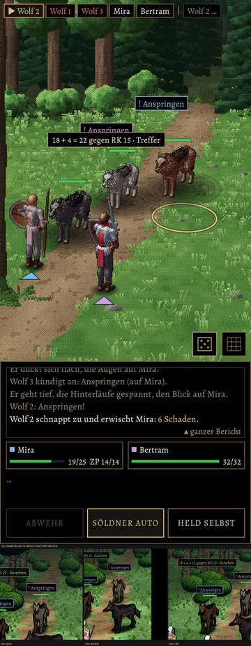
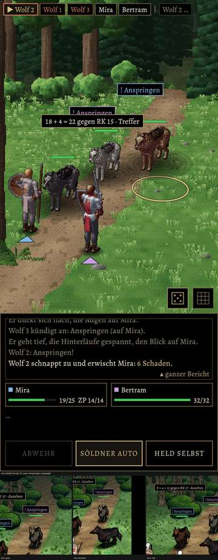

# 348.7 · Wolf und Grimmzahn Runde 10 · Jerry · 25.10., 20:33

 

Oben alt, unten neu (Godot): links Stand, rechts Lauer vor dem Sprung. Großbild: Telegram 25.10., 20:3x (`bilder:pruefung/348.7-wolf-r10-stehen`, `-lauer`, Grimmzahn `-1`). Runde 10 ist die letzte nach der 10-Runden-Regel; Feinschliff nur auf dein Wort.

**Befund (Helfer, Diogenes 20:33):** Helligkeit frei (grau, rost 15–19 % dunkler, dunkel gleich); grauer Wolf eher Kojote; Lauer schwach, Hinterläufe „wie Reh“ eingeknickt; Bauchplatte (Form, nicht Licht); grau zu warm und gesättigt. Grimmzahn: Narbe liest sich als weiße Sichel, Ohrriss unsichtbar, Schnauze hell, nur 1,3-mal so groß.

**Sag:** „Wolf steht“ (die Punkte kommen ins Feintuning) oder was zuerst geändert werden soll.
