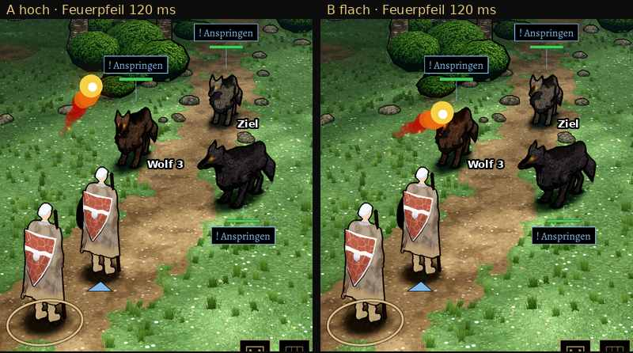
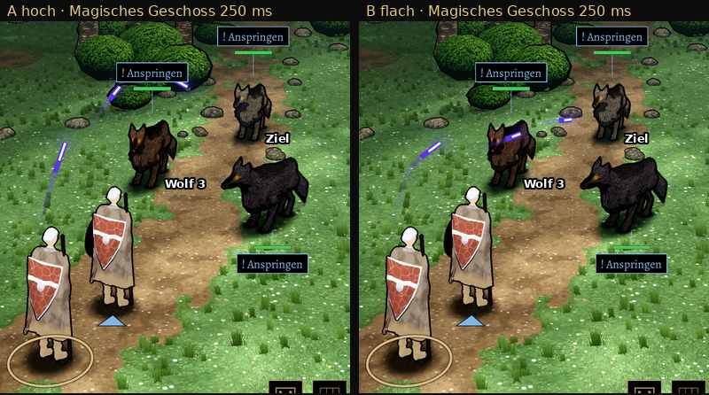
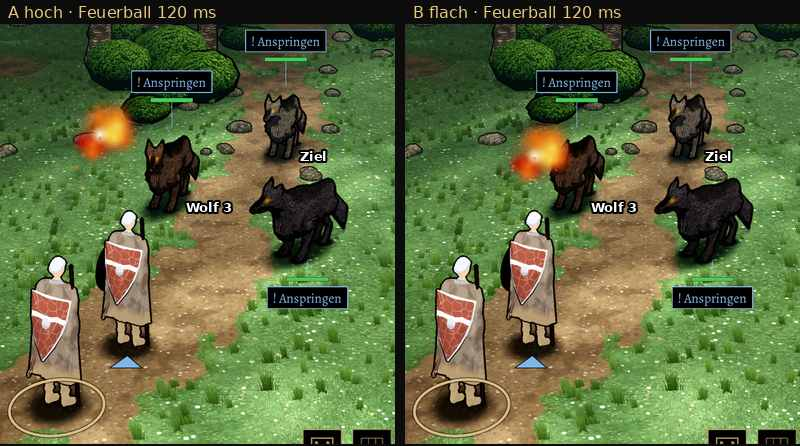

# 348.7b · Zauberbahn hoch über die Köpfe (A) oder flach quer über Wolf 3 (B)? · Jerry · 27.10., 18:33
Kurz: Zauberbahn A hoch über die Köpfe oder B flach quer über Wolf 3?

**Frage:** In der Aufstellung des Wolfsrudels stehen Mira und Wolf 3 am Schirm wie eine Wand zwischen Magier (unten links) und Wolf 1 (oben rechts). Jede Bahn muss entweder hoch drüber (A) oder quer über Wolf 3 (B). Welche?

**Votum:** A („348.7b A“). Danach räume ich in A die Ansage von Wolf 3 frei (siehe Befunde).

**Berührt:** 348.7, 348.7a (Geschosse in 3D, Maß altes MARS).

**Ansehen:** [Film A|B, 23 s](https://cdn.jsdelivr.net/gh/tramour-cmyk/androidapp_rpg_bornim@bilder/pruefung/3487b-bahn.mp4) (Echtzeit: Magier, dann Kleriker mit Pfeil und Pfeil daneben; danach Magier halb so schnell)

**Befunde der Fehlerprüfung (fremder Prüfer, eine Runde, nichts „hoch“):**
- mittel, A: Die Bahn streift die Ansage von Wolf 3 („! Anspringen“), Scheitel nur 48 px über dem Kasten. Der Feuerball ist bei 250 ms zu einem Drittel hinter dem Kasten, das Geschoss kommt unter der Kastenecke hervor.
- mittel, B: Das Geschoss liegt bei 250 ms quer über Gesicht und Augen von Wolf 3 (etwa 100×30 px). Der Feuerpfeil liegt bei 120 ms vor Ohr und Kopf (etwa 60×60 px), der Feuerball über Kopf und Brust.
- mittel, A und B: Der Pfeil ist ein blasser Strich von 10 bis 15 px und nur etwa 0,2 s zu sehen. Der Pfeil daneben ist im Film nicht als Fehlschuss zu erkennen: Er streift Wolf 1, der Fleck daneben steht nur 1 bis 2 Bilder.
- gering, Film: An beiden Schnitten zum Kleriker springt das Bild 0,1 s lang in einen anderen Spielstand (Probe, nicht im Spiel).
- gering: Strahl in geraden Stücken mit Knicken. Magier und Mira sind schwer zu unterscheiden (Figur des Helden, bei Tom offen). Der Lebensbalken bleibt in der Probe voll (Probe ohne Schaden).

**Begründung:** A verdeckt keine Figur außer dem Ziel. Das alte MARS, unser Maß (Archiv 348.7a), malte die Geschosse ebenfalls über alle hinweg (`BattleFx.kt` `arc`). B legt jeden Zauber für etwa 0,2 s vor einen Wolf, der nicht getroffen wird. Am kleinen Schirm sieht das aus, als träfe er Wolf 3.

Sachverhalt, Auswertung, Folgerungen

**Sachverhalt** (lokal in Godot, Commit 5b3333855, Schalter `BAHN=hoch`; Probe `BAHN_PRUEF=1`):
- Gezählt sind die Bahnpunkte, die am Schirm über einer anderen Figur liegen.
- Feuerpfeil, Strahl und Feuerball: A 3, B 8 (B ist r7).
- Magisches Geschoss: A 9, B 26.
- A: Spitze spät bei 70 % des Wegs, bis 1,5 m hoch.
- B: Spitze früh, höchstens 0,9 m hoch.
- Je Bild: B kreuzt Wolf 3 von 0,19 bis 0,37 s; A kreuzt nur das Ziel kurz vor dem Einschlag.

**Auswertung:**
- Stärkstes Gegenargument gegen A: Ein Feuerpfeil im hohen Bogen fliegt wie ein Wurfgeschoss, nicht wie ein gezielter Schuss. Ein früherer Prüfer fand ihn „vier Kopfhöhen über Mira“ zu hoch (r3). Das ist eine Frage der Wirkung, darum entscheidest du.
- Dritter Weg C (nicht gebaut): die Aufstellung ändern, damit die Schusslinie frei ist, also der Magier nicht hinter Mira. Das wäre die Ursache selbst. Es greift aber in Kampfort und Regeln ein, und jede andere Aufstellung erzeugt wieder eigene Kreuzungen.

**Folgerungen:**
- „A“: Jerry setzt `BAHN=hoch` als Regel und lässt die Bahn über die Ansagen steigen oder die Ansagen beim Durchflug zurücktreten. Danach neue Fehlerprüfung; Fledermaus r4d und Wildschwein r3 kommen wieder an dich.
- „B“: r7 bleibt. Das Geschoss weicht dann nur noch über die Seite aus.
- „C“: Jerry legt ein Blatt mit zwei Aufstellungen vor.

Antwort:
