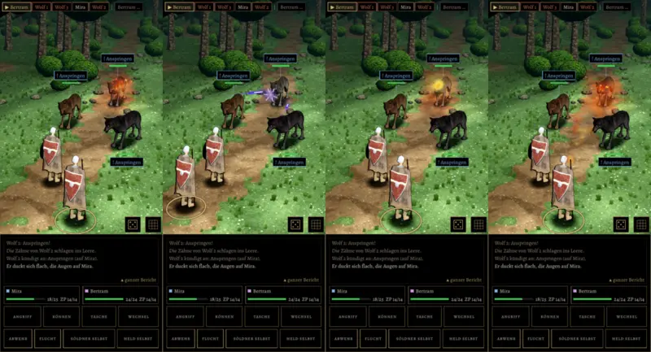

# 348.7b · Zauberbahn Runde 4 (deine Wahl „b“) · Team Jerry · 28.10., 15:17

**Bitte ansehen:** [Film](https://cdn.jsdelivr.net/gh/tramour-cmyk/androidapp_rpg_bornim@bilder/2026-10/28-1517-348.7b-Jerry.mp4) (Telegram 28.10., 15:17), 13 s. Der Magier ist Söldner, gegen drei Wölfe; er zaubert nacheinander Feuerpfeil, Magisches Geschoss, Feuerball, Brennende Hände.

**Geändert (dein „b“ 10:43):** Steht der eigene Held in der Linie, tritt der Magier bis 2 m zur Seite (hier 1,6 m), bevor er zaubert. Das Zieldreieck am Boden fällt weg, solange eine Figur davor darauf steht.

**Sag:** „348.7b passt“ oder was nicht stimmt. Danach ist die Zauberbahn fertig (dein „dann Schluss“).

Der Befund des fremden Prüfers kommt nach dem Senden als Text (Archiv 396).
