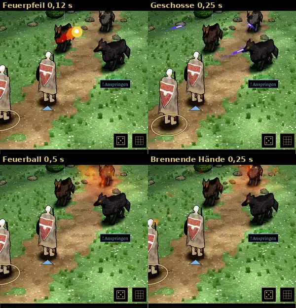

# 348.7b · Zauberbahn nach deinem „D“, Runde 2: gerade Linie, Seitenschritt zur Bildmitte, Geschosse im Fächer, Kegel · Team Jerry · 28.10., 06:30

**Morgenblatt** (zum Ansehen am Morgen). Ersetzt Runde 1 (06:12). Stand nach den zwei erlaubten Probeläufen (389).

**Frage:** Passen gerade Linie, Seitenschritt, Fächer der Geschosse und der Kegel der Brennenden Hände so? Sag „ja“ oder was anders sein soll.

**Bitte ansehen:** [Film](bilder:pruefung/348.7b-zauberbahn-r2.mp4), 10,7 s. Bertram steht hinten links, die Heldin vor ihm (am Grundplatz). Feuerpfeil mit Seitenschritt ab 5,9 s; Magisches Geschoss ohne Schritt 7,2–7,4 s; Feuerball mit Schritt ab 8,2 s; Brennende Hände mit Schritt ab 9,4 s, Kegel 9,7–9,8 s.

**Was gebaut ist:**
- Jeder Zauber startet an der Stabspitze, sonst an der Hand. Feuerpfeil, Strahl und Feuerball fliegen gerade zur Brust des Ziels. Sie fliegen über Köpfe und Ansagen einfach hinweg. Die alte Wegsuche über die Köpfe ist entfernt.
- Steht ein eigener Mann in der Linie, tritt der Wirkende 0,3–1,0 m zur Seite, zur Bildmitte hin, wirkt und tritt zurück. Das ist nur Bild, keine Bewegung im Kampf. Gegner machen es ebenso (im Probekampf: Goblin hinter Grak). Ein Gegner in der Linie zählt nicht.
- Magisches Geschoss: kein Schritt, drei Bögen wie im alten Kampf, zur Seite aufgefächert.
- Feuerball: gerade zum Ziel, dort die Explosion.
- Brennende Hände: eigener Effekt statt Feuerball, ein Flammenkegel aus den Händen bis zum Ziel. Er erlischt von den Händen her; solange er brennt, bleibt Bertram am Seitenplatz. Gemessen ist er etwas schwächer als die Explosion des Feuerballs.
- Pfeil: unverändert leichter Bogen.

**Was der fremde Prüfer gefunden hat:**
- Behoben seit Runde 1: Bertram bleibt beim Schritt ganz im Bild. Der Kegel ist zu sehen, Wolf 1 steht darin. Am Seitenplatz bleibt nach dem Zurücktreten nichts stehen.
- In Ordnung: Start an Stabspitze oder Hand, Feuerpfeil und Feuerball gerade, Rückkehr an den Platz, keine eigene Figur durchquert, drei getrennte Geschosse, Explosion auf Wolf 1.
- **Offen:**
  - Am Grundplatz steht die Heldin vor Bertram, am Seitenplatz steht er im Bild genau vor ihr und verdeckt ihren Unterkörper (im Raum 1,5 m von ihr weg). Feuerpfeil und Feuerball beginnen darum im Bild auf Höhe ihrer Brust und Schulter. Der Feuerball liegt 1–2 Bilder lang über ihrer rechten Schulter, es sieht kurz aus, als käme er aus ihr.
  - Zwei Geschosse ziehen ihre Spur vor dem Schild der Heldin vorbei, je etwa 0,07 s. Im Raum laufen sie vor ihr, nicht durch sie.
  - Beim Kegel fliegt die ersten zwei Bilder ein Feuerklumpen, erst dann steht der Kegel.
  - Bertram gleitet beim Hintreten, ohne die Beine zu bewegen (beim Zurücktreten nach dem Feuerball bewegt er sie). Die Figur hat noch keine eigene Schritt-Bewegung (Toms Figuren: nur Gehen und Stehen).
  - Ein Geschoss fliegt durch den Kopf von Wolf 2. Wolf 2 ist ein Gegner, darum nach deiner Regel egal.
  - Die Heldin zuckt kurz in eine Schrittpose, vermutlich ihr alter Ruheschritt (gehört Team Tom).

**Danach:** Nach deinem Wort baue ich die offenen Punkte ein, dann folgt der Kampfort mit Fledermaus und Wildschwein (348.7).
