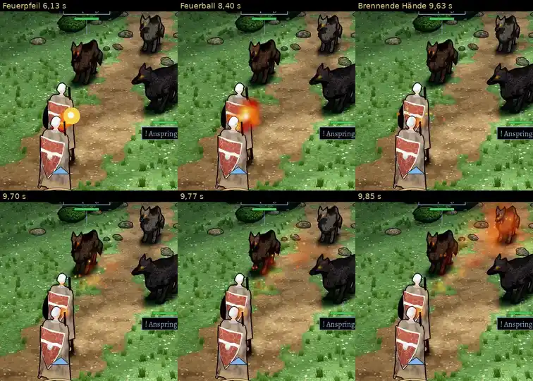

# 348.7b · Zauberbahn Runde 3: kein Feuerklumpen mehr; der Start liegt im Bild noch immer vor der Heldin · Team Jerry · 28.10., 08:35

**Frage:** Bertram steht nach dem Seitenschritt im Bild vor der Heldin. Darum scheinen Feuerpfeil, Feuerball und der Flammenkegel in den ersten Bildern aus ihr zu kommen. Soll das so bleiben (a), oder soll er weiter nach rechts treten, bis er im Bild neben ihr steht (b)?

**Votum:** b. Bei den Brennenden Händen sieht es vier Bilder lang aus, als brenne die Heldin.

**Bitte ansehen:** [Film](https://cdn.jsdelivr.net/gh/tramour-cmyk/androidapp_rpg_bornim@bilder/pruefung/348.7b-zauberbahn-r3.mp4), 10,7 s. Feuerpfeil ab 5,9 s, Magisches Geschoss ab 7,2 s, Feuerball ab 8,2 s, Brennende Hände ab 9,4 s.

**Geändert seit Runde 2:**
- Brennende Hände: Vorher flog in den ersten zwei Bildern ein Feuerklumpen los. Jetzt wächst der Kegel vom Ansatz aus, schmal am Ansatz und breiter zum Ziel. Der Ansatz liegt im Bild aber auf der rechten Schulter der Heldin (siehe Frage). Sobald der Kegel voll steht, sieht er aus wie in Runde 2. Der fremde Prüfer bestätigt: kein Klumpen, kein Ball.
- Seitenschritt: Er meidet jetzt einen Platz, von dem aus die Bahn im Bild über einer eigenen Figur beginnt, wenn es einen besseren gibt. In dieser Aufstellung gibt es keinen.
- Die Zauberbahn steht als Regel in `LISTE-UMZUG-348.md` (Abschnitt „Zauberbahn“).

**Warum der Start noch auf der Heldin liegt** (gemessen): Bertram tritt 0,8 m nach rechts. Im Raum steht er dann 1,5 m von ihr weg, im Bild aber genau vor ihr. Bei jedem erlaubten Schritt nach rechts (0,3–1,0 m) beginnt die Bahn im Bild über ihr. Jeder Schritt nach links führt aus dem Bild. Für b müsste sein Schritt nach rechts nach Rechnung etwa 1,7 m lang sein statt 0,8 m. Das ist kein kleiner Schritt mehr, er ginge sichtbar.

**Was der fremde Prüfer sonst gefunden hat:**
- Feuerpfeil: In den ersten zwei Bildern (6,13 und 6,17 s) liegen Ball und Spur über ihrer rechten Schulter.
- Feuerball: Zwei Bilder lang (8,40 und 8,43 s) liegt er über ihrem Schild und ihrer Schulter und deckt Bertrams Kopf, ab 8,47 s ist er frei.
- Brennende Hände: Von 9,63 bis 9,73 s liegen Funken auf ihrem Schild und Hals.
- Magisches Geschoss: Alle drei starten an Bertrams Kopf, nicht an der Hand (der Code nimmt die Hand; ich prüfe, ob der Bogen sofort steigt). Zwei fliegen über den Schild der Heldin und sind über ihr gemalt. Eines fliegt erst nach links oben fast bis an den Bildrand, dann zu Wolf 1, 0,2 s länger.
- Bertram verdeckt nach dem Seitenschritt ihre untere Hälfte. Ihr blaues Dreieck unter den Füßen liegt dabei über ihm.
- Wolf 3 steht im Kegel und glüht an Beinen und Augen rot mit, obwohl nur Wolf 1 das Ziel ist. Der Feuerball fliegt über die Brust von Wolf 3, ein Geschoss streift den Kopf von Wolf 2 (Gegner, nach deiner Regel egal).
- Im Feuerball ragt ein Bild lang die Nase von Wolf 1 als dunkler Punkt heraus.
- Figuren von Team Tom (an Tom offen): Bertram und die Heldin sehen gleich aus. Links an ihrem Schild ist eine flache schwarze Fläche. Je ein Bild lang (2,57 und 4,47 s) stehen beide in Gehhaltung.
- Nur in dieser Probe, nicht im Kampf: Wolf 3 fehlt von 4,4 bis 5,5 s, dann springen alle Wölfe auf neue Plätze. Lebensbalken und Zauberpunkte ändern sich nicht.
- In Ordnung: Bertram kehrt jedes Mal genau an seinen Platz zurück und bleibt ganz im Bild. Nach dem Zurücktreten bleibt nichts stehen.

**Danach:** Bei a prüfe ich den Geschossstart, behebe das Dreieck und mache mit Fledermaus und Wildschwein im Kampfort weiter (348.7). Bei b baue ich zuerst den längeren Schritt und lege ihn vor.
