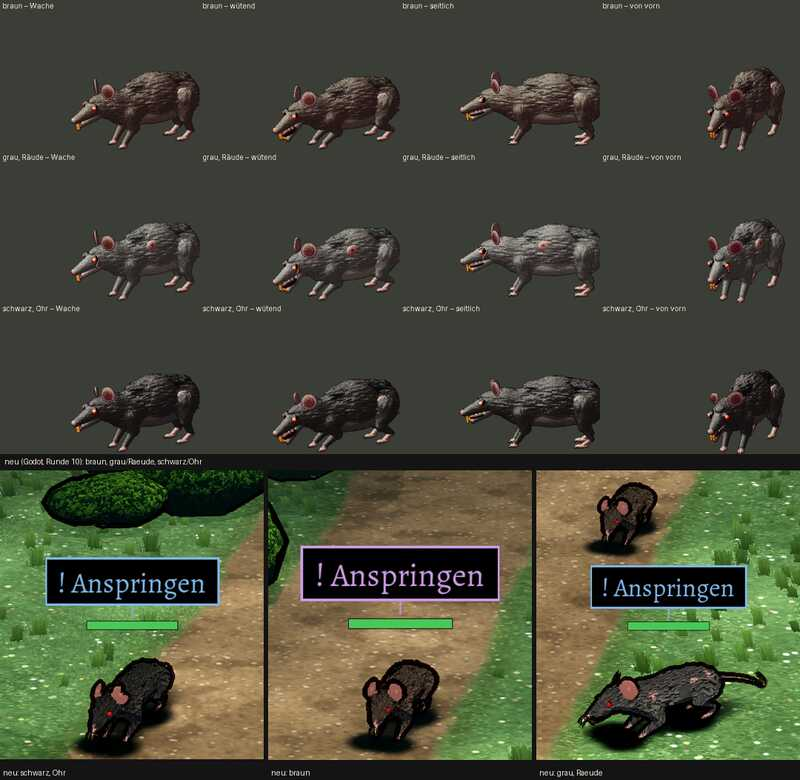

# 348.9 · Riesenratte Runde 10 (die letzte) · Jerry · 25.10., 17:25

Oben alt (gezeichnete Entwürfe), unten neu im Kampfort (übliche Ansicht): braun, grau mit Räude, schwarz mit zerrissenem Ohr. Gedrehte Ansichten: Zweig `bilder`, `pruefung/348.9-ratte-r10-1.png` (vorn), `-2` (seitlich), `-3` (schräg hinten); volles Bild auch auf Telegram.

**Geändert nach deinem Wort zu Runde 8:** Fell als kurze, dichte Strähnen mit Lichtkante in einer Wuchsrichtung (vorher feiner als ein Bildpunkt); gemessene Fellstruktur jetzt nahe alt (braun 17,5/alt 18,7, grau 20,4/25,2, schwarz 12,9/17,6; Runde 9: 12,7, 17,7, 10,8). Nagezähne länger als Runde 9, elfenbein, zwei Spitzen mit Spalt; Maul im Stehen halb offen. Helligkeit etwa wie alt (mein Maß, Median neu/alt: braun 45/44, grau 60/60, schwarz 31/34).

**Befund Helfer (3 Fassungen):** Fell erstmals als Fell lesbar, von der Seite stellenweise wie zerknittertes Papier. **Zähne: dein Wunsch nach „bösen Zähnen“ ist im Bild nicht erfüllt.** Erkennbar nur bei der grauen Ratte und von der Seite als kleine helle Nagezähne; bei Braun und Schwarz von vorn im Schatten unsichtbar, „böse“ wirken sie nirgends; das halb offene Maul ist in Spielgröße nicht zu sehen. Grau: ein glatter dunkelgrauer Fleck ohne Fell auf der Rückenmitte. Dunkler Spitz hinter dem Ohr, von der Seite wie ein kleines Horn. Ohren flache Scheiben, Hinterbeine ohne sichtbare Pfoten und Krallen.

**Diogenes (17:21):** frei, nichts heller oder bunter; Median neu/alt braun 34/48, grau 56/61, schwarz 27/33 (sein Rahmen, dunkler als mein Maß). Weiter: grau anthrazit statt mittelgrau, Bauch nicht hell, keine Krallen, Auge ohne Glanz, Umriss treppig.

**Sag:** „Ratte steht“ (Fleck, Ohrspitz, Ohren, Pfoten, Bauch auf dein Wort später) oder was bei den Zähnen anders werden soll (Vorschlag: deutlich größer und heller, Maul beim Drohen weit offen); Runde 11 nur auf dein Wort (Grenze 10).
