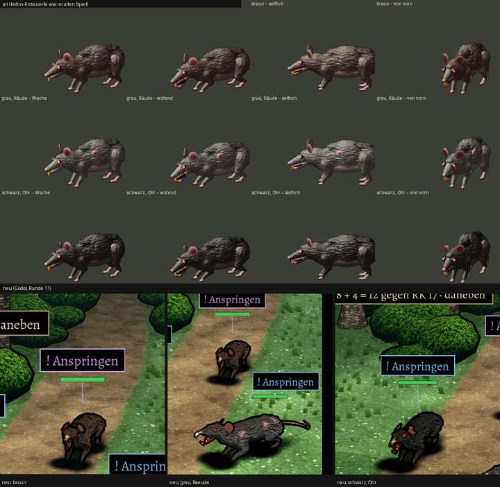

# 348.9 · Riesenratte Runde 11 · Jerry · 25.10., 18:58

Oben „alt“: die Entwürfe aus dem alten Spiel (Wache, wütend, seitlich, von vorn), unten die neuen Ratten im Kampfort, wie man sie im Spiel sieht: braun, grau mit Räude, schwarz mit zerrissenem Ohr. Die gedrehten Ansichten liegen im Zweig `bilder` unter `pruefung/348.9-ratte-r11-1.png` (von vorn), `-2` (von der Seite) und `-3` (schräg von hinten). Das volle Bild ist auch auf Telegram.

**Geändert nach deinem Wort von 18:32:**
- **Größe:** Schulterhöhe 0,6 m, so groß wie ein großer Hund. Im Kampf stehen die Ratten jetzt in echter Größe neben dem Wolf, also drei Viertel seiner Höhe. Alt war es knapp die Hälfte. Im Blatt ist kein Wolf zu sehen, im Kampfbild auf Telegram stehen die Helden daneben.
- **Haltung:** Die Ratten lauern mit vorgestrecktem, gehobenem Kopf und weit aufgerissenem Maul. Das Maul ist rot und wird nach hinten zum Schlund dunkel.
- **Zähne:** Vorn zwei breite Nagezähne. In jedem Kiefer sitzen dazu vier spitze Reißzähne. Echte Ratten haben keine, aber erst mit ihnen liest sich das Maul als gefährlich.
- **Einzelheiten:** Die Ohren sind kleiner und dunkler, die Krallen länger.

**Befund Helfer (drei Prüfrunden, 11a bis 11c; die ersten beiden sind behoben):** Das Bild liest sich jetzt als Angriff: drei aufgerissene rote Mäuler mit Zähnen und rote Augen, „man nimmt das Tier ernst“. Am besten wirken die graue Ratte und die Seitenansicht. Offen:
- **Von vorn lesen sich die Nagezähne der braunen und der schwarzen Ratte als gelber Kamm oder Gabel. Darunter hängen dunkle Fransen wie ein Bart.**
- Von vorn wirkt das Maul wie ein flaches rotes Dreieck, den Schlund sieht man dort nicht.
- Die Krallen erkennt man in Spielgröße nicht.
- Braun und Schwarz sind kaum zu unterscheiden.
- Die Räude wirkt wie rosa Flecken.
- An der grauen Ratte sitzt neben dem Ohr eine spitze Zacke, die wie ein Horn aussieht.

- Laut Helfer sind die Ratten dunkler und weniger bunt als alt.

**Diogenes:** nicht gemessen, weil keine Sitzung läuft.

**Sag:** „Ratte steht“ (die offenen Punkte kommen dann ins Feintuning) oder „Runde 12“ (dann zuerst die Nagezähne von vorn und der Bart, danach das Maul von vorn). Runde 11 lag schon über der Grenze von 10 Runden.
