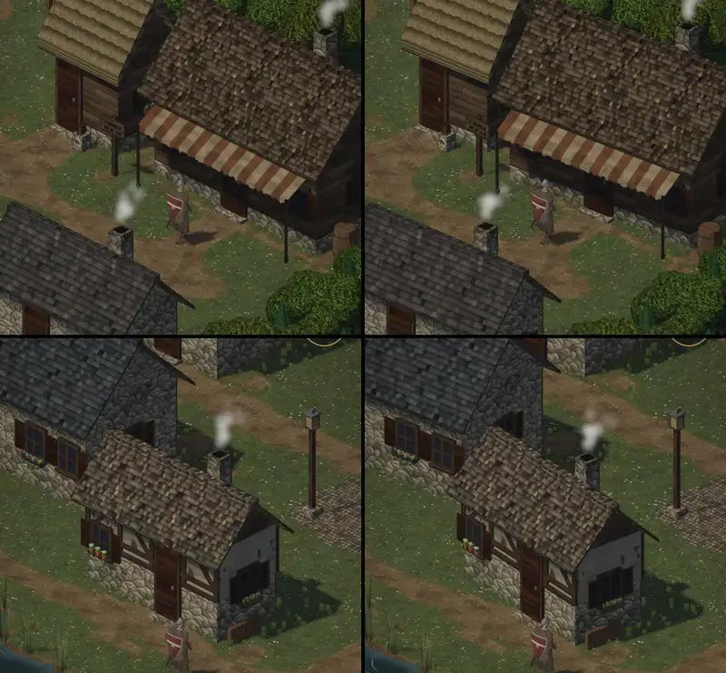

# 376 · Häuser leicht gedreht: so? · Tom · 27.10., 18:08

**Frage:** Du hast um 12:42 „376 ja“ gesagt: Häuser 3 bis 8 Grad drehen, auf ihren Kacheln, Tür zum Weg. Links wie bisher, rechts gedreht. So lassen, stärker, oder zurück?

**Votum Tom: stärker, 6 bis 12 Grad.** Bei 3 bis 8 Grad sieht man die Drehung nur im direkten Vergleich. Stärkstes Gegenargument: stärker gedreht rücken Häuser enger aneinander (schon jetzt der Laden an das Strohdachhaus, oben) und stehen mit einer Ecke über dem Weg.

**Wie:** jedes Haus dreht sich um seine Haustür, so bleibt die Tür am Weg; Richtung wechselt nach Lage; die Kirche bleibt gerade.

**Berührt:** 348.6 (Dorf).

## Sachverhalt

**Fremde Prüfung (18:07), eine Runde:** nichts steckt ineinander, kein Haus schwebt, alle Türen am Weg, Schatten drehen mit.
- gering: Laden rückt an das Strohdachhaus heran (Abstand der Dachkanten 123 → 74 Bildpunkte), das Blumenfenster dazwischen ist fast verdeckt.
- gering: Regentonne am Holzhaus steht nicht mehr bündig an der Wand (Lücke etwa 18 Bildpunkte).
- gering: Laternensockel und Schilder auf Pfosten neben den Türen drehen nicht mit (freistehend).
- Drehung im Bild: Traufkanten ändern ihre Richtung um 3 bis 7 Grad, am Steinhaus und Holzhaus kaum.

**Noch offen aus 376:** das Probehaus aus dem Dorfbausatz von Quaternius, mit unseren Texturen, neben einem unserer Häuser; kommt als eigene Vorlage.
