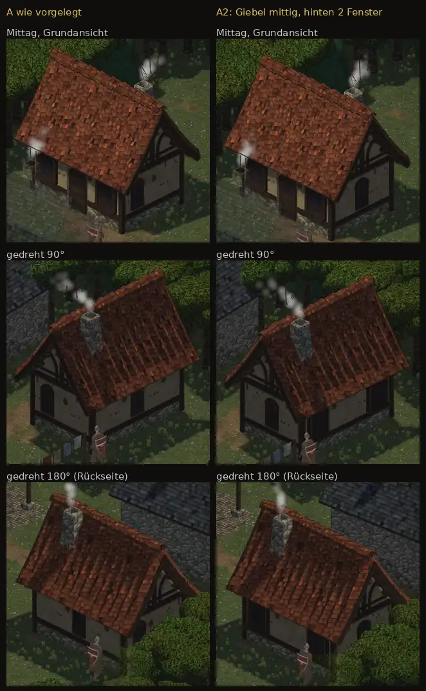

# 376 · Probehaus: Giebelfenster mittig und Fenster hinten? · Tom · 27.10., 22:00

**Deine Frage (19:38):** ob es das Fenster an der Ostseite auch mittig gibt und ob auf der Rückseite noch ein Fenster geht; „Ist das möglich mit den neuen Bausätzen?“

**Antwort: ja, beides.** Der Bausatz setzt jede Wand aus Stücken von 2 m zusammen; jedes Stück gibt es glatt, mit schmalem oder breitem Fenster oder mit Tür. Für ein mittiges Giebelfenster kommt das Fensterstück in die Mitte, links und rechts je ein halbes glattes Stück. Hinten passt in jedes der drei Stücke ein Fenster.

- **A, wie vorgelegt:** Giebelfenster nicht mittig (an der Ostseite zur Front hin, an der Westseite zur Rückseite hin); hinten schon ein schmales Rundbogenfenster in der Mitte.
- **A2, als Beispiel:** beide Giebelfenster mittig; hinten zwei breite Fenster wie vorn, die Mitte glatt. Jede andere Verteilung geht ebenso.

**Votum Tom: A2 mit mittigen Giebelfenstern.** Stärkstes Gegenargument: mit zwei breiten Fenstern hinten sieht die Rückseite fast wie die Front aus; ist dir das zu gleich, bleibt hinten das schmale Fenster aus A.

**Innenraum:** Das Probehaus ist Gwennas Haus; es hat keinen Innenraum, die Tür bleibt verschlossen. Ändert sich nichts. Bekommen Häuser mit Innenraum den Bausatz (Schänke, Laden, Ältester, Tempel), richte ich die Fenster im Innenraum nach den Wänden außen aus; das ist ein eigener Vorgang.

**Ansehen:** Bilder groß: [A Mittag](https://github.com/tramour-cmyk/androidapp_rpg_bornim/blob/bilder/pruefung/376-fenster-neu-mittag_grund.jpg), [A2 Mittag](https://github.com/tramour-cmyk/androidapp_rpg_bornim/blob/bilder/pruefung/376-fenster-a2-mittag_grund.jpg), [A2 gedreht 90°](https://github.com/tramour-cmyk/androidapp_rpg_bornim/blob/bilder/pruefung/376-fenster-a2-mittag_dreh90.jpg), [A2 gedreht 180°](https://github.com/tramour-cmyk/androidapp_rpg_bornim/blob/bilder/pruefung/376-fenster-a2-mittag_dreh180.jpg), [A2 Nacht](https://github.com/tramour-cmyk/androidapp_rpg_bornim/blob/bilder/pruefung/376-fenster-a2-nacht_grund.jpg).

**Berührt:** 348.6 (Dorf). Bestand geprüft: `LISTE-BESTAND.md`, Medieval Village MegaKit; genommen: Putzwände glatt und mit Fenster, Fenster schmal rund und breit.

## Fremde Prüfung (21:51)

- Bauplan bei A und A2 eingehalten: Giebelfenster bei A2 mittig (Abweichung höchstens 5 Bildpunkte, Messrauschen), hinten zwei Fenster, Mitte glatte Wand.
- Keine Spalten, Nähte oder Verzerrung an den halben Wandstücken; Dach, Schornstein und Front bei A und A2 gleich.
- Behoben: Das Haus war in den Ausschnitten angeschnitten; jetzt ganz im Bild. Die Ansicht „gedreht 270°“ (West und Front) fehlt im Blatt, weil von dort Büsche die Westwand verdecken; in „gedreht 180°“ ist sie frei.
- Gering: In den Mittagsansichten verdeckt die Traufe die Rundbögen von Tür und hinterem Fenster (wie in A vorgelegt). An der rechten Türlaibung ein grünlicher Streifen, in A und A2 gleich. Die linke Frontecke liegt in der Grundansicht hinter dem halb durchsichtigen Nachbarhaus.

## Folgerungen

Sagst du A2, baue ich das Probehaus so und gehe weiter mit dem Dorf; die übrigen Häuser stelle ich nicht von selbst auf den Bausatz um. Sagst du A, bleibt es wie vorgelegt.

Antwort: A2, A oder was anders
