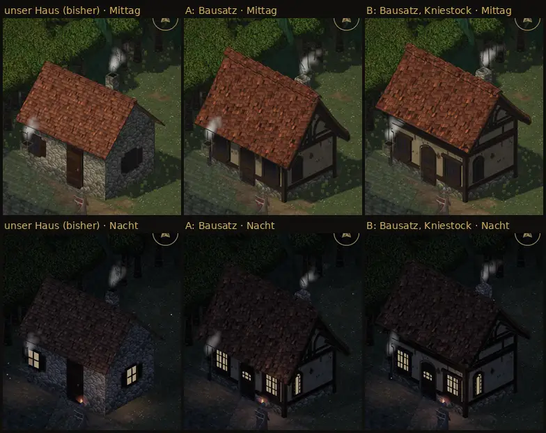

# 376 · Probehaus aus dem Dorfbausatz: A, B oder unser Haus? · Tom · 27.10., 19:17

**Frage:** Du hast um 12:42 „376 ja“ gesagt, auch zum Probehaus: ein Haus aus dem freien Dorfbausatz von Quaternius mit unseren Texturen, neben unseren Häusern. Links unser Haus wie bisher, Mitte A, rechts B. Welches: A, B oder bei unserem bleiben?

**Votum Tom: B, falls du den Bausatz willst.** Bei A hängt die Traufe des Bausatzdachs so tief, dass sie in unserer Draufsicht den Türbogen und die Fensteroberkanten verdeckt. B setzt Dach und Giebel auf eine Putzzone (Kniestock) und macht das Dach etwas flacher; dann sind Tür und Fenster ganz zu sehen. Stärkstes Gegenargument: B ist nicht mehr der Bausatz, wie er gedacht ist, und das Haus wird höher: der Umriss ist bei A 13 %, bei B 16 % höher als bei unserem Haus; mit B liegt die Traufe 30 Bildpunkte über der des Nachbarhauses (Kachel 3/18).

**Berührt:** 348.6 (Dorf). Bestand geprüft: `LISTE-BESTAND.md`, Medieval Village MegaKit, daraus verwendet: Putzwände, Rundziegeldach, Ziegelgiebel, Holzecken, Schornstein.

## Sachverhalt

- Gleiche Kacheln wie unser Haus, Front in einer Flucht mit unseren Häusern, Maßstab etwa 0,75 des Bausatzes. Farben und Texturen sind unsere: Putz, Balken, Feldstein, Ziegel.
- Bilder in voller Größe: [A Mittag](bilder:pruefung/376-probehaus-a-mittag_grund.jpg), [B Mittag](bilder:pruefung/376-probehaus-b-mittag_grund.jpg), [A nah](bilder:pruefung/376-probehaus-a-mittag_nah.jpg), [B nah](bilder:pruefung/376-probehaus-b-mittag_nah.jpg), [A Nacht](bilder:pruefung/376-probehaus-a-nacht_grund.jpg), [B Nacht](bilder:pruefung/376-probehaus-b-nacht_grund.jpg).

**Fremde Prüfung (19:02 und 19:16), Befunde:**
- Behoben: Der Schornstein steckte bis auf eine Kante im Dach. Er steht jetzt bei A und B gut sichtbar über dem Dach, der Rauch kommt aus dem Kopf.
- A: Die Traufe verdeckt die Oberkante von Tür und Fenstern, deshalb ist die runde Tür nicht als rund zu erkennen.
- Tür im Verhältnis zur Figur: A 1,03, B 1,10, Nachbarhaus (Kachel 3/18) 1,20.
- Höhen in Bildpunkten (etwa):

  | Haus | Traufe | First |
  |---|---|---|
  | A | 170 | 480 |
  | B | 250 | 500 |
  | Nachbarhaus | 220 | 345 |

- Gering:
  - unter der Firstkappe eine dunkle, treppige Fuge, 2–4 Bildpunkte breit;
  - an der Westecke liegt bei A der Eckpfosten, bei B dazu ein Fallrohr im Bild hinter dem Brunnenstumpf des Nachbarn; dass etwas ineinandersteckt, ist nicht nachweisbar;
  - bei B ein heller Zwickel von etwa 10 × 14 Bildpunkten zwischen Giebelstrebe und Balken, eher Putz als Loch.
- Ohne Befund:
  - nichts schwebt oder steckt im Boden, keine falschen Texturen;
  - Schatten fallen wie beim alten Haus;
  - nachts leuchten Fenster, Türglas und Giebelfenster in ihren Rahmen.

**Folgerungen:** Sagst du A oder B, baue ich die übrigen Häuser in diesem Stil nicht von selbst um; das wäre ein eigener Vorgang. Sagst du „unser Haus“, nehme ich das Probehaus wieder heraus.

Antwort: …
