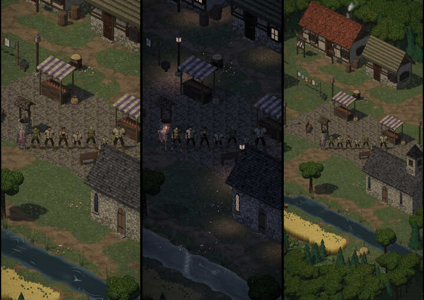

# 376.1 · Probeblatt Quaternius-Figuren · Tom · 27.10., 14:06

**Ansehen:** drei Blätter in Godot mit unserem Toon, Tusche und Licht: [Dorf Tag, Nacht, weit](https://github.com/tramour-cmyk/androidapp_rpg_bornim/blob/bilder/pruefung/3761-figuren-reihe.jpg), [Nahstufe](https://github.com/tramour-cmyk/androidapp_rpg_bornim/blob/bilder/pruefung/3761-figuren-nah.jpg), [Hauptmenü-Licht](https://github.com/tramour-cmyk/androidapp_rpg_bornim/blob/bilder/pruefung/3761-figuren-menue.jpg). Von links: unser bisheriger Held, dann Quaternius-Held, Bauer, Bäuerin, Zwerg, Elfe, Halbling, Halbork. Zweig `claude/tom-376-1-figuren`.

**Nur freie Teile:** der Zugang zu den gekauften Dateien fehlt noch (Freigabe `add_repo` in der Sitzung). Darum Kopf „Superhero“ statt „Regular“, Waldläufer statt Ritter, nur zwei Kleidungen (Bauer, Waldläufer), freie Bewegungen. Die gekauften setzt der Nachfolger danach nur noch ein.

**Fehlerprüfung (fremde Helfer, drei Runden):** behoben: weißes Haar (jetzt getönt), Halbork ohne Grün, Figur im Marktstand, Völker kaum verschieden, Menülicht. Offen:
- mittel: Stehhaltung der Quaternius-Bewegungen starr (Arme 23° abgespreizt, breitbeinig, Kopf gesenkt). Unser Held nutzt dieselbe Quelle mit eigener Korrektur, die sich übernehmen lässt.
- mittel: vier Figuren im gleichen Kittel, zwei im gleichen Grün (freie Kleidung).
- mittel: Elfe: Haar über dem halben Gesicht, kaum als Frau zu erkennen; Völker nur über Größe, Breite, Hautton (keine spitzen Ohren, keine Hauer).
- mittel: Menü: unser Held mit schwarzen Schienbeinen; Ringstufen im Lichtkegel.
- gering: Halbling-Beine hinter der Laterne (Aufstellung); kleiner heller Fleck an der Schulternaht der Kittel.

**Zahlen:** Dreiecke je Figur 18–33 Tsd., unser Held 6 Tsd.; 13 Figuren am A56 also etwa 250–430 Tsd., nicht gemessen.

**Film:** Raster mit 15 Feldern (Stehen, Gehen, Rennen, Sitzen, Gesten, Hieb, Stich, Ausweichen, Treffer, Tod, Kampfstehen; Kampf je neben unserer Runde 7) kommt nach der Fehlerprüfung.

**Sag:** je Blatt, was dir gefällt und was nicht; zum Film je Feld „ja“ oder „nein“.
