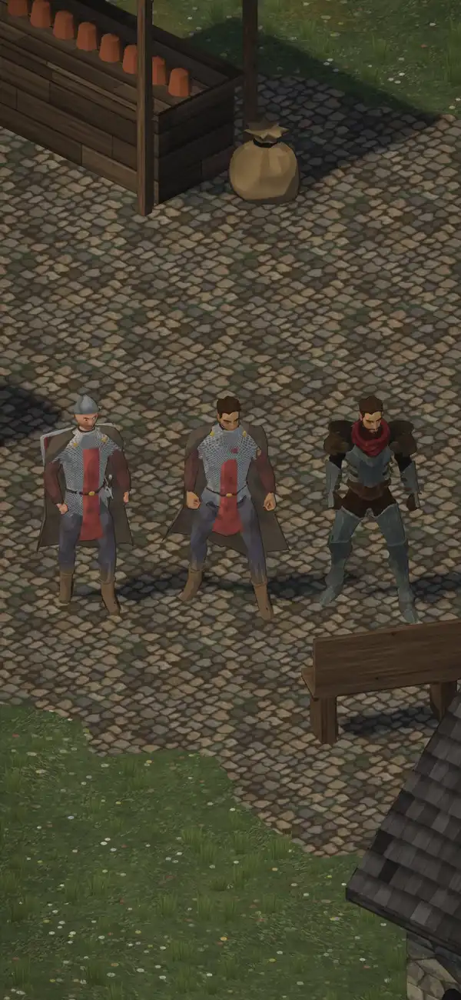

# 376.1 · Kauffigur in unserer Kleidung: Richtung richtig? · Tom · 27.10., 17:46

**Frage:** Du wolltest um 15:23 „eine Kauffigur in unserer Kleidung“. So sieht sie mit gekauftem Körper, unserem Kopf und unserer Kleidung aus (Fehler unten). Weiter in diese Richtung: ja, nein, oder was soll anders sein?

**Votum Tom: ja**, dann die Fehler unten beheben. Stärkstes Gegenargument: der Kopf wirkt noch wie der gekaufte, nicht wie unserer; ob „unser Kopf“ auf dem gekauften Körper trägt, ist damit noch nicht gezeigt.

Die Bewegungen (Film) folgen als eigene Frage, sobald der korrigierte Film geprüft ist; der verlinkte Film unten ist der alte, nur zum Eindruck.

**Ansehen** (alles im Zweig `bilder`): Tracht [vorn](https://github.com/tramour-cmyk/androidapp_rpg_bornim/blob/bilder/pruefung/3761-tracht-vorn.jpg), [hinten](https://github.com/tramour-cmyk/androidapp_rpg_bornim/blob/bilder/pruefung/3761-tracht-hinten.jpg), [Köpfe schmal/rund, mit/ohne Bart](https://github.com/tramour-cmyk/androidapp_rpg_bornim/blob/bilder/pruefung/3761-tracht-koepfe.jpg), [nachts](https://github.com/tramour-cmyk/androidapp_rpg_bornim/blob/bilder/pruefung/3761-tracht-nacht.jpg) (16:43). [Figurenfilm mit Kaufteilen](https://cdn.jsdelivr.net/gh/tramour-cmyk/androidapp_rpg_bornim@bilder/pruefung/3761-figuren-kauf-film.mp4) (15:23, vor den Korrekturen). Blätter Kaufteile: [Reihe](https://github.com/tramour-cmyk/androidapp_rpg_bornim/blob/bilder/pruefung/3761-figuren-kauf-reihe.jpg), [nah](https://github.com/tramour-cmyk/androidapp_rpg_bornim/blob/bilder/pruefung/3761-figuren-kauf-nah.jpg), [Menü](https://github.com/tramour-cmyk/androidapp_rpg_bornim/blob/bilder/pruefung/3761-figuren-kauf-menue.jpg).

**Berührt:** 348.6 (Umzug Dorf, Leute), 372 (Held), 376.2.

## Sachverhalt

**Tracht, fremde Prüfung 16:48:**
- hoch: hinten Kettenhemd und roter Rock durch den Mantel; vorn Haut an der linken Schulter, rotes Dreieck durch die Brust; Köpfe schmal und rund kaum zu unterscheiden (Kopf gesenkt, Kragen verdeckt Kinn und Mund); nachts Fackelschein magenta, Mitte ohne Quelle hell, Kettenhemd fast weiß.
- mittel: braune Stücke an der Hüfte, Stiefel ohne Fuß, „ohne Bart“ mit Stoppeln, Kopf wirkt wie der Kaufkopf, A-Haltung mit Fäusten, keine Beschriftung, nachts kein Schatten, Tusche gleich dünn.

**Alter Film, fremde Prüfung 16:36** (nur zur Einordnung; die drei schweren Fehler sind behoben, der neue Film wird gerade erzeugt): schwer: Tod auf dem Dach, Klinge im Hals, Gehen gleitet. Mittel: Klinge am Schienbein (Feld 9), Ausweichen ohne Ortswechsel, eigene Klinge schwarz gestrichelt (7, 8, 10, 12), Stich nach unten (8), Bauer gestikuliert stehend (5), Treffer schwach (11), Sitzen still (4). Diogenes: Felder 7, 8, 10, 12 gleiche Pose, Tod angeschnitten, Menülicht bunt.

**Blätter, fremde Prüfung 14:57:** hoch: Halbling hinter Kirchendach und Laterne, Halbling im Kittel wirkt wie ein Kind, Elfe ohne spitze Ohren und eher männlich, Ringstufen im Menü-Lichtkegel. Mittel: keine Figur hält etwas, schwarze Oberarme (Ritter, Halbork), brauner Klumpen auf Zwergs Schulter, Halbork ohne Hauer und im Menülicht gelb, Stehen starr, keine Namen, Elfe und Halbork nachts kaum lesbar.

**Sag:** zur Tracht „ja“, „nein“ oder was anders sein soll.
