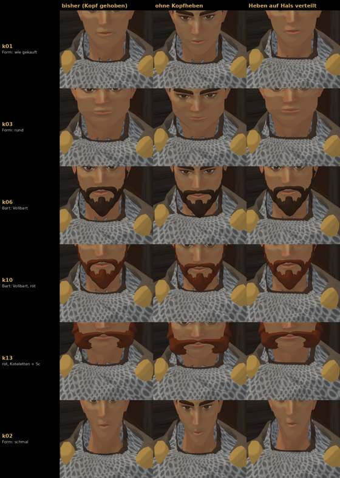

# 376.1 · Halszacken: drei Fassungen des Kopfhebens · Tom · 28.10., 12:28

Volle Größe per Telegram. Zeilen: sechs Köpfe, unten k02 (Form schmal) ohne Zacken zum Vergleich. Spalten: bisher (Kopf um 8–12° gehoben, nur der Kopfknochen), ohne Kopfheben, Heben auf Hals und Kopf verteilt. Ein Helfer vergleicht die Spalten, sein Befund folgt als Text.

**Was du sagen sollst:** nichts nötig; wenn du hinsiehst: in welcher Spalte die grauen Zacken vorn am Hals weg sind.
