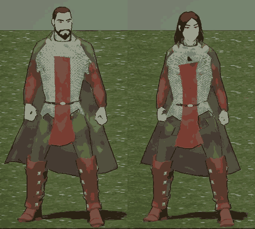

# 376.1 · Kettenhemd der Heldin: so lassen, nachbessern oder Ritterin Platte?
Sokrates · 01.11., 20:57 · E Figuren

**Ansehen:** Bild oben (Stand, von vorn); in Bewegung im [Film 376.1 von 15:25](https://cdn.jsdelivr.net/gh/tramour-cmyk/androidapp_rpg_bornim@bilder/2026-11/01-1525-376.1-Spike.mp4): Mann ab Sekunde 1, Frau ab Sekunde 13 (jeweils oben links „Wachsoldat“), Gehen und Rennen auf Seite 3.

**Frage:** Die Wachsoldatin trägt dasselbe Kettenhemd wie der Mann, einmal an den Frauenkörper angepasst (Archiv 376.1, 11:19). Lassen wir es so, bessern wir nach oder nehmen wir die gekaufte Ritterin in Platte?
**Votum Sokrates:** nachbessern, nicht als eigene Probe, sondern im ohnehin laufenden Vorgang 463 (Umhang und Robe dicht).

## Was falsch ist

- **Im Stand** (Bild) fällt wenig auf: das Hemd wölbt sich an der Brust leicht, kleiner schwarzer Fleck links am Hals, Flanken unruhiger als beim Mann.
- **In Bewegung** (gemessen, `pruef_tracht.py`, acht Bewegungen): Haut stößt bei der Frau an bis zu 71 Stellen durchs Hemd, beim Mann an 16. Der Prüfer sah im Film die Brust durchs Kettenhemd und ein schwarzes Dreieck unter dem Hals; dasselbe Dreieck zeigt Film 455.2 bei den Frauen aller Völker.

## Die drei Wege

| Weg | Was du bekommst | Was es kostet | Haken |
|---|---|---|---|
| **A so lassen** | nichts weiter | nichts | Brust und Haut scheinen in jeder Bewegung durch, verstößt gegen Grundstand B4 (Kleidung geschlossen) |
| **B nachbessern** | Kettenhemd der Frau so dicht wie das des Mannes | kein eigener Lauf: geht in 463 mit | erst im nächsten Trachtfilm zu sehen |
| **C Ritterin Platte** | fertige Rüstung, sofort | nichts | Wachsoldatin trüge Platte, der Wachsoldat Kette: widerspricht deinem Wort „Mann und Frau gleich“ (376.1, Grundstand B3); das Kettenhemd im Laden (`chain_shirt`) bliebe für jede Heldin kaputt |

## Wie B gelöst wird

- **Ursache:** unter dem Hemd ist der ganze Körper noch da; bewegt sich die Brust, stößt sie durch das dünne Netz. Die Anpassung des Netzes allein (Runde vom Vormittag) ließ noch 71 Stellen.
- **Lösung:** Haut, die eine Kleidung verdeckt, wird nicht gezeichnet (Körper unter dem Kleidungsstück ausblenden, in Spielen üblich). Was nicht gezeichnet wird, kann nicht durchstoßen. Das ist genau die Ursache, die 463 für Umhang und Robe prüft; einmal gebaut, gilt sie für jedes Kleidungsstück, jedes Volk, Mann und Frau.
- Dazu Brustform im Netz der Frau, damit es nicht flach wirkt, und das schwarze Dreieck am Hals schließen.
- **Nachweis:** im nächsten Trachtfilm (auf dem Grundstand-Zweig) die Zahl je Bewegung, Ziel höchstens wie beim Mann; davor geht kein Film raus (Grundstand B4).

**Stärkstes Gegenargument:** C ist heute fertig, B erst nach 463. **Entkräftet:** 463 muss ohnehin gebaut werden (Umhang, Robe, „DAUERPROBLEM“); das Kettenhemd fährt dort mit, kostet keinen Lauf extra, und C würde zwei deiner Entscheidungen brechen.

**Zu sagen:** „376.1 Kettenhemd B“ (nachbessern mit 463), „A“ oder „C“.
