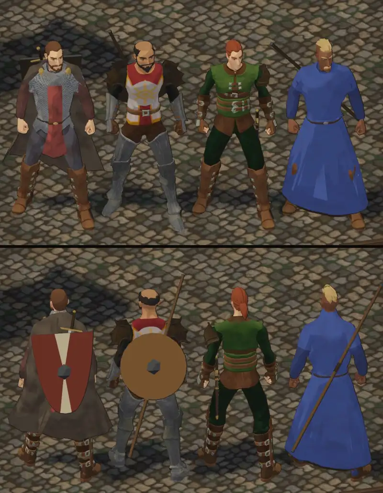
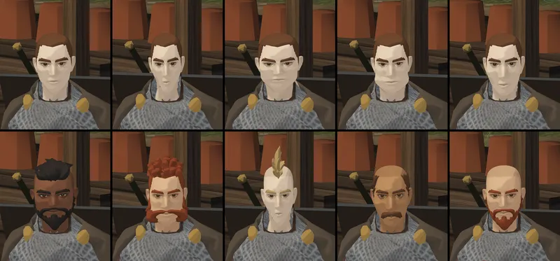
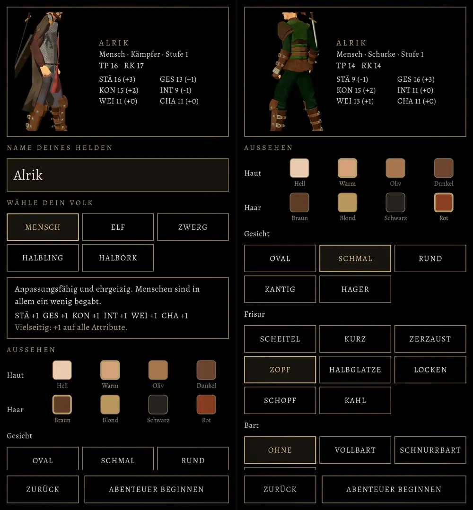

# 376.1 · Held in vier Klassen: Köpfe, Haut, Robe · Tom · 29.10., 02:10

Bilder aus der Vorschau am Rechner (kein Handy-Build; der nächste Build kommt nach deinem Wort mit 376.1 und den Innenräumen 399.5). Umgesetzt nach deinem Urteil vom 28.10., 23:0x (Klassenentwürfe). Von links: Kämpfer, Kleriker, Schurke, Magier; oben von vorn, unten von hinten.

- **Beispielköpfe:** jede Klasse trägt einen fertigen Kopf als Vorgabe (Kämpfer kantig mit Vollbart, Kleriker rund mit Halbglatze und Bart, Schurke schmal mit Zopf, Magier hager mit Schnurrbart). So verstanden: „die Beispielköpfe auf die Helden“. Wählt der Spieler in der Erschaffung selbst, bleibt seine Wahl.
- **Haut:** keine Klasse hat mehr „Hell“ als Vorgabe. Das Licht nahm der Haut die Farbe (Wange bei „Warm“ grau-beige, Rot nur wenig über Grün); jetzt hat das Gesicht den Farbton des gewählten Farbfelds, eher dunkler als das Feld, nie heller, und behält die Rötung von Wangen und Lippen des gekauften Kopfs.
- **Magier:** lange Robe bis zu den Knöcheln im Blau des alten Spiels, ohne Umhang, Stiefel aus dem Kaufpaket.
- **Kleriker:** goldene Sonne auf Brust und Rücken wie im alten Spiel (hinten vom bisherigen Rundschild verdeckt); Arm- und Beinschienen ohne Mintstich. Den hellen Rundschild mit Sonne baut Team Jerry (406, Ausrüstung).
- **Kämpfer:** Stiefel aus dem Kaufpaket (unsere sahen wie Holzpflöcke aus, mit Loch); Schild auf dem Rücken 20 cm tiefer gehängt, weil er von vorn über die Schultern ragte.

Obere Reihe: die fünf Gesichter (oval, schmal, rund, kantig, hager); „kantig“ beulte an der Wange, jetzt mit schmalerem Kiefer und kräftigerem Kinn; „hager“ länger mit eingefallenen Wangen. Untere Reihe: die vier Hauttöne des Menschen (hell, warm, oliv, dunkel) und als Probe die Frisur „Schopf“ mit Koteletten.

Erschaffung: der Kasten mit dem Helden ist größer und zeigt ihn von den Knien bis zum Kopf, damit Gesicht und Bart zu sehen sind; Frisuren heißen nach Homer „Zerzaust“, „Locken“, „Schopf“ (405).

Noch nicht: weibliche Helden, Körperbau je Volk (Zwerg, Elf …), Statur; Held im Kampfort (Jerry, 403); Ausrüstung je Stück (Jerry, 406).

**Was du sagen sollst:** je Klasse „passt“ oder was anders sein soll; ob die vier Hauttöne jetzt stimmen.
