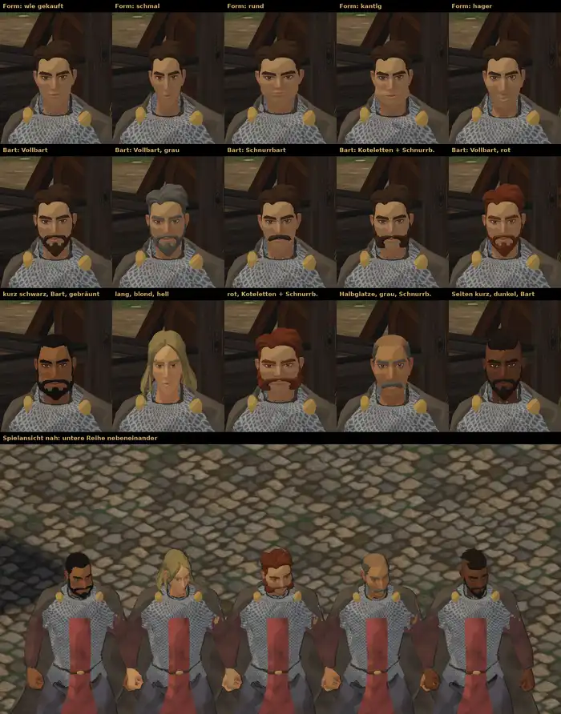

# 376.1 · Gekaufter Kopf angepasst: Form, Bart, Farbe, Haar · Tom · 27.10., 21:19

**Frage:** Am 27.10. um 19:40 wolltest du den gekauften Kopf angepasst haben: „dann Bart dran und Farbe ran. Und Haare“. So sieht es aus. „ja“ = so weiterbauen (Fehler unten beheben, Formen deutlicher), danach als Auswahl in die Charaktererstellung; „nein“ = der gekaufte Kopf bleibt unverändert, nur Haar und Bart wechseln; oder sag, was anders sein soll.

**Votum Tom: ja.** Stärkstes Gegenargument: die Kopfformen unterscheiden sich in unserem flachen Comic-Licht nur schwach (der fremde Prüfer verwechselt „wie gekauft“ mit „rund“ und „schmal“ mit „hager“). In der Spielansicht erkennt man die Figuren vor allem an Haar und Bart, kaum am Gesicht.

**Ansehen:** [Blatt groß](bilder:pruefung/3761-koepfe.jpg), [Spielansicht](bilder:pruefung/3761-koepfe-spiel.png).

**Berührt:** Charaktererstellung, Leute im Dorf (348.6), Held (372).

## Sachverhalt

**Was geht:** Der gekaufte Kopf hat keine fertigen Formregler. Wir formen ihn selbst an gemessenen Punkten des Gesichts: Breite, Kiefer, Länge, Kinn, Nase, Wangen und Brauen. Im Blatt: fünf Formen (wie gekauft, schmal, rund, kantig, hager), fünf Frisuren, sechs Haarfarben, fünf Hauttöne und drei Bärte (Vollbart, Schnurrbart, Koteletten; bei Vollbart und Koteletten ist der Schnurrbart fest dabei). Im Paket sind 13 Frisuren; Farben und Hauttöne sind frei wählbar. Stoppeln sind in unserem Licht nicht zu sehen, darum gibt es sie nicht zur Wahl.

**Behoben seit der Vorlage zur Kleidung (27.10., 16:48):** Der Kettenkragen verdeckt Kinn und Mund nicht mehr. Von vorn ist der Kopf nicht mehr gesenkt. An den Schultern stechen keine Kettensplitter mehr durch den Umhang. Rock und Kettenhemd stechen in Bewegung deutlich seltener durch den Umhang.

**Fremder Prüfer 21:17, offen:**
- hoch: „kantig“ wirkt wie Hängebacken mit Knick, nicht wie ein kantiger Kiefer. In der Spielansicht ragen an allen fünf Figuren am Oberarm (im Bild rechts) hautfarbene Splitter zwischen Kettenhemd und Ärmel heraus.
- mittel: in der Spielansicht wirken die Köpfe noch gesenkt (Kamera von oben oder Haltung, nicht zu trennen). Kleine graue Zacken am Kragenrand mitten am Hals (11 von 15 Köpfen). Kaum unterscheidbar: „wie gekauft“ und „rund“, „schmal“ und „hager“. Kinnränder der Bärte und Haaransatz gezackt; Koteletten enden blockig. In der Spielansicht stehen die Figuren zu eng.

## Folgerungen

Nach deinem Ja: die offenen Fehler beheben, die Formen weiter auseinander, dann Auswahl in die Charaktererstellung (zusammen mit 302.1 Tuschelinie der Figuren und 357 Puppe beim Drehen). Die Bewegungen der gekauften Figur kommen als eigene Vorlage.

Antwort: ja, nein oder was anders
